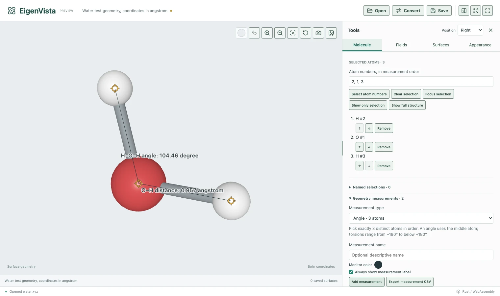
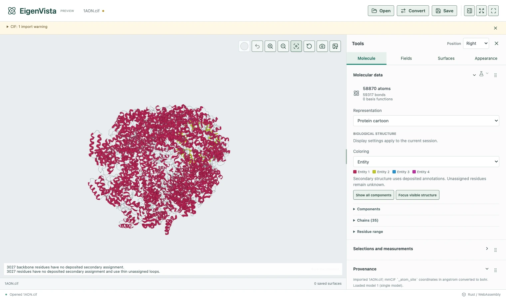
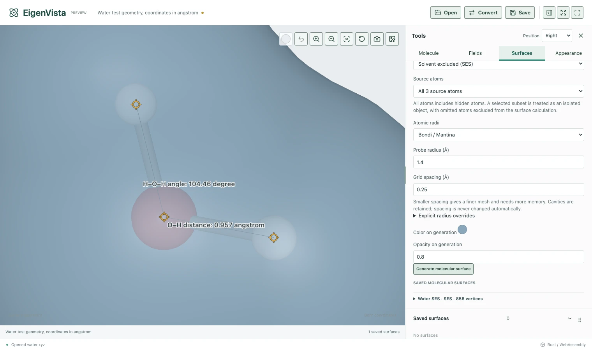

# Chemistry and biomolecules with an agent

Drive EigenVista 0.10.6 by describing the structure and evidence you want. Use a coding agent with terminal and file access on the computer running the desktop app. Start a connector-enabled session and give the agent its nonsecret `session-note.txt` path. The note points to the private descriptor, which stays on your machine. [Set up EigenVista](../setup.md).

Copy each prompt into the connected agent. Let each step finish before sending the next one. Inputs go in an approved input directory and outputs use new files in the approved results directory. Include the packaged `SKILL.md` and `reference.md` in the agent's context if needed. [Official AI connection guide](https://uvar-apps.github.io/eigenvista/ai-install.html).

<figure class="tutorial-media">
  <video data-kind="tour" controls playsinline preload="none" width="1600" height="900"
    aria-label="Chemistry and biomolecules with the AI connector" poster="../../assets/media/chemistry/stills/assembly-chain.webp">
    <source src="../../assets/media/chemistry/tour-agent.mp4" type="video/mp4">
    <track kind="captions" src="../../assets/media/chemistry/tour-agent.vtt" srclang="en" label="English" default>
    <track kind="chapters" src="../../assets/media/chemistry/tour-agent-chapters.vtt" srclang="en" label="Chapters">
  </video>
  <figcaption>Measure water, inspect a deposited protein assembly, and build a solvent surface.</figcaption>
</figure>

[Read the walkthrough transcript](../assets/media/chemistry/tour-agent-transcript.txt).

## Confirm the connection and measure water

> Read the packaged EigenVista connector instructions and my session note. Use the bundled helper to discover capabilities and inspect the authorized window. Tell me the app version and whether a document is open, keeping the descriptor contents private. Preserve unsaved work before changing files. Open water.xyz from the approved Inputs folder, downloading the example from https://uvar-apps.github.io/eigenvista/downloads/water.xyz into Inputs if needed. Resolve the oxygen and two hydrogen identities. Save a measurement for the first O–H distance and one for the H–O–H angle, with oxygen at the vertex. Label the oxygen and save a named set for all three source atoms. Read back the values and export a new water-measurements.csv, water-inspection.png and water-inspection.eigenvista in my Results folder. Report paths and PNG dimensions.

**Check the result.** 3 atoms, 2 display bonds, O–H about **0.9572 Å** and H–O–H about **104.46°** for the linked input. Compare the reported numbers with the CSV and check the image for the annotations. Connector source indices start at zero. The GUI atom numbers start at one.

*Check these values against the connector's readback before using the exported report.*

## Change scale and inspect a deposited fold

> Open 1AON.cif. If I have not already placed it in the Inputs folder, use https://uvar-apps.github.io/eigenvista/downloads/1AON.cif and download it into that folder first. Verify the input is mmCIF and report the imported counts, component kinds, and whether secondary structure is deposited. Clear any previous filters and representation overrides and use the complete structure. Preview Protein backbone trace, Protein smooth tube, and Protein ribbon. Frame it in Protein cartoon and save new Chain-colored and Entity-colored PNGs from the same camera. Then resolve deposited label chain A with author A, isolate it, frame it, and export a new Secondary-structure-colored PNG. Tell me what the legends represent and how the app shows unassigned regions. Return to the whole assembly, show the protein in Protein cartoon and set the ligand component to Ball and stick.

**Check the result.** 58,870 selected atoms and 35 imported chain instances for the linked file. Chain colors identify distinct deposited chain instances. Entity colors group instances with the same deposited entity ID. The chain A PNG shows an isolated view of the original document, and gray in its secondary-structure legend indicates unassigned regions. [RCSB PDB 1AON](https://www.rcsb.org/structure/1AON).

*Entity coloring groups copies by deposited entity. The captured viewport shows the state the agent should verify before export.*

## Generate and export comparable surfaces

> Open the same water.xyz from Inputs again in a clean document. Use Ball and stick and generate an SES and a separate SAS from all three source atoms. Use Bondi/Mantina radii for both, a 1.4 angstrom probe, and 0.25 angstrom spacing. Wait for each job and check its accepted settings and mesh counts. Fit a view containing the larger surface, then toggle visibility and export each one separately while keeping the camera fixed. Apply the connector X-ray preset (`x-ray`) to the SES only, export a separate PNG, then clear the shader. Save a new water-surface-comparison.eigenvista retaining both meshes and report what settings I need to repeat the X-ray presentation.

**Check the result.** two cached meshes with different surface kinds and the same input atoms, radii, probe, and spacing. With the linked XYZ and these settings, expect **1,712 SES triangles** and **5,848 SAS triangles**. Treat SES/SAS as coordinate-derived molecular shapes. For a matte comparison, request built-in shading, fully opaque saved surfaces, and the molecular-surface AO switch. PNG background transparency is independent of a surface's opacity. Save retains the accepted meshes and annotations. The camera, biological filters, palette, AO, background, and shader are session controls that need a settings record alongside exported images.

*Confirm the accepted probe and grid settings in the app and match the mesh count to the agent's report.*

## Try a second presentation of the same structure

> Return to 1AON after saving the water work. Show Van der Waals spheres and Element coloring. Load the bundled MatterViz Pastel palette from an approved input path identified by the session note. Compare with and without atom-and-bond ambient occlusion at one camera. Keep the comparison on the atomic representation. Report what the palette and the shading change in the picture.

The palette changes element colors. Ambient occlusion emphasizes apparent contacts and crevices. The imported identities and coordinates are independent of those settings. Use the [atomic packing tutorial](https://uvar-apps.github.io/eigenvista/ai-tutorial-ao.html) for a matched image comparison.

## Check what the connector did

Ask the agent to report terminal job status before describing new results. It should resolve IDs from the open document and preserve existing inputs and export files. For saves, check the receipt reports a saved current revision. For pictures, check the exported dimensions and capture revision. [Connector reference](https://uvar-apps.github.io/eigenvista/downloads/eigenvista-control/reference.md).

## Continue with a workflow

- [Compare protein representations and colorings](workflows/protein-cartoon-agent.md)
- [Inspect one deposited ligand neighborhood](workflows/ligand-neighborhood-agent.md)
- [Compare SES and SAS at fixed parameters](workflows/solvent-surfaces-agent.md)
- [Measure local coordination geometry](workflows/coordination-geometry-agent.md)
- [Follow this tour in the GUI](gui.md)
