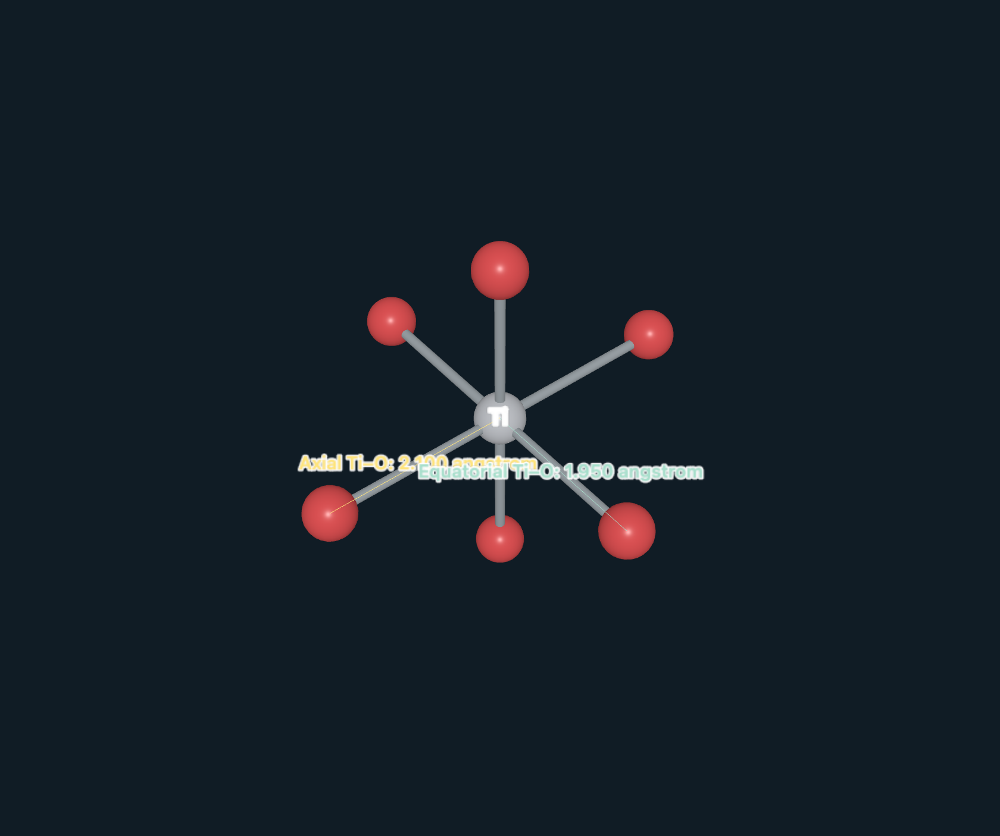
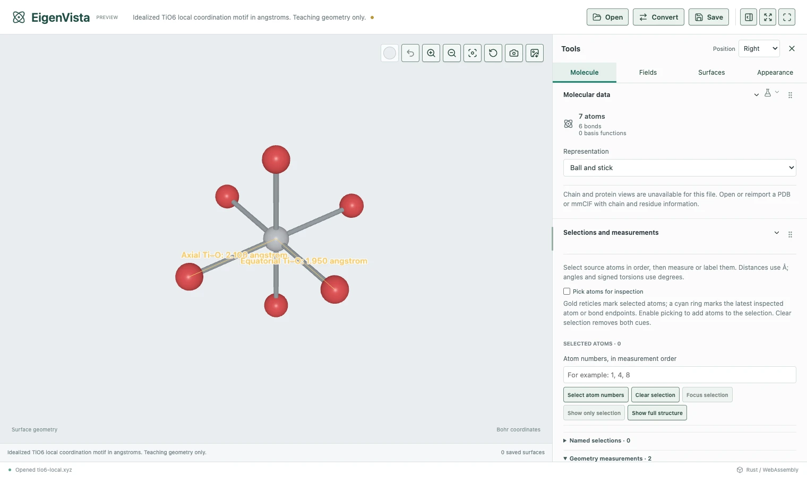

# Measure local coordination geometry with an agent

Compare equatorial and axial metal–oxygen distances using an idealized local structure. Download [tio6-local.xyz](../data/tio6-local.xyz) into the approved Inputs folder for your connector-enabled EigenVista 0.10.6 session, then give your agent the session note path. The seven-atom XYZ stores Cartesian coordinates in Å. [Set up EigenVista](../../setup.md).

<figure class="tutorial-media">
  <video data-kind="workflow" controls playsinline preload="none" width="1600" height="900"
    aria-label="Measure and export a TiO₆ local site" poster="../../../assets/media/chemistry/stills/coordination-distance-controls.webp">
    <source src="../../../assets/media/chemistry/coordination-geometry.mp4" type="video/mp4">
    <track kind="captions" src="../../../assets/media/chemistry/coordination-geometry.vtt" srclang="en" label="English" default>
    <track kind="chapters" src="../../../assets/media/chemistry/coordination-geometry-chapters.vtt" srclang="en" label="Chapters">
  </video>
  <figcaption>Select the oxygen sites by identity, compare two distances, and export the figure and table.</figcaption>
</figure>

## Download the result

Download the [annotated PNG](../../assets/media/chemistry/results/tio6-local-geometry.png){: download="tio6-local-geometry.png" } and [measurement CSV](../../assets/media/chemistry/results/tio6-local-geometry.csv){: download="tio6-local-geometry.csv" }. The figure shows the two distance monitors. The CSV also preserves the two angles, the signed torsion, and the atom order.

## Resolve site identities and measure

> Use my authorized EigenVista session. Preserve any unsaved work. Open tio6-local.xyz in my approved Inputs folder. Confirm that the source has seven atoms and identify the one titanium at the origin and the oxygens along each axis by reading back their coordinates with explicit units. Save measures for the Ti–O distance along +x and along +z, the O(+x)–Ti–O(+z) angle, and the O(+z)–Ti–O(−z) angle. Add a signed torsion using the ordered points O(+x), Ti, O(+y), O(+z). Name the measures by identity and read back their values and units from EigenVista.

Expect **1.950 Å** for +x, **2.100 Å** for +z, **90°** for the equatorial–axial angle, **180°** for the opposite axial angle, and **−90°** for this ordered torsion. Connector atom positions are in bohr and indices are zero-based. `measure.evaluate` and `measure.list` return distances in Å and angles/torsions in degrees. A result of `undefined` includes the reason. [Connector reference](https://uvar-apps.github.io/eigenvista/downloads/eigenvista-control/reference.md).

*Compare the app measurement table with the results the agent reports.*

## Save an annotated comparison

> Keep Ball and stick and frame the whole site. Label the titanium and display only the two distance monitors for the figure. Keep all five definitions in the document. Save a new PNG, a measurement CSV, and a new native document in my approved Results folder. Give me the files, their source identity, the axial-minus-equatorial difference in angstroms, and the PNG dimensions. Describe it as a comparison of the supplied local coordinates.

Expect a difference of **0.150 Å**. To adapt to a catalyst cluster or cutout from a solid, give the agent the source and expected metal/neighbor identities. Use an exported model that explicitly includes the periodic images you intend to measure. A Cartesian distance from the imported model alone cannot establish a bond order, oxidation state, adsorption energy, or catalytic mechanism. [EigenVista file reference](https://uvar-apps.github.io/eigenvista/reference-files.html).

[Follow the same workflow in the GUI](coordination-geometry-gui.md) · [Back to the chemistry agent tour](../agent.md)
