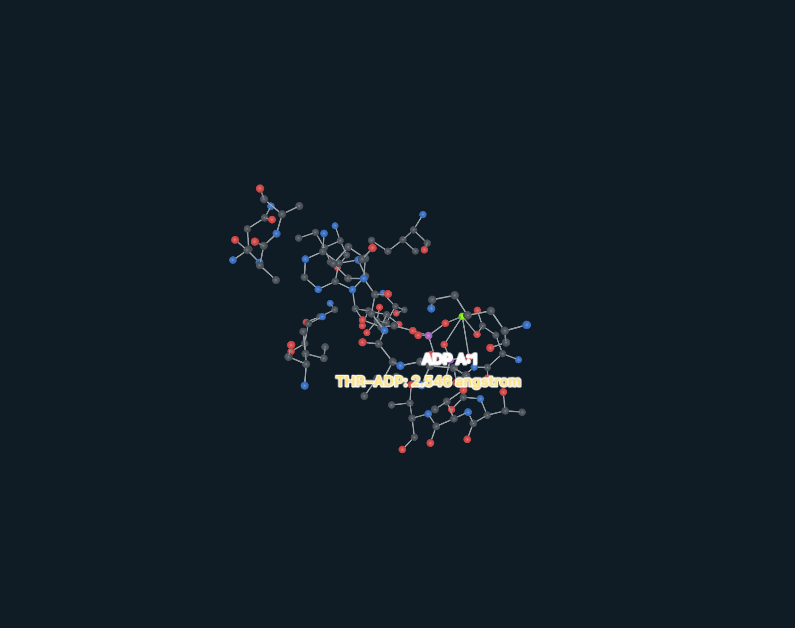
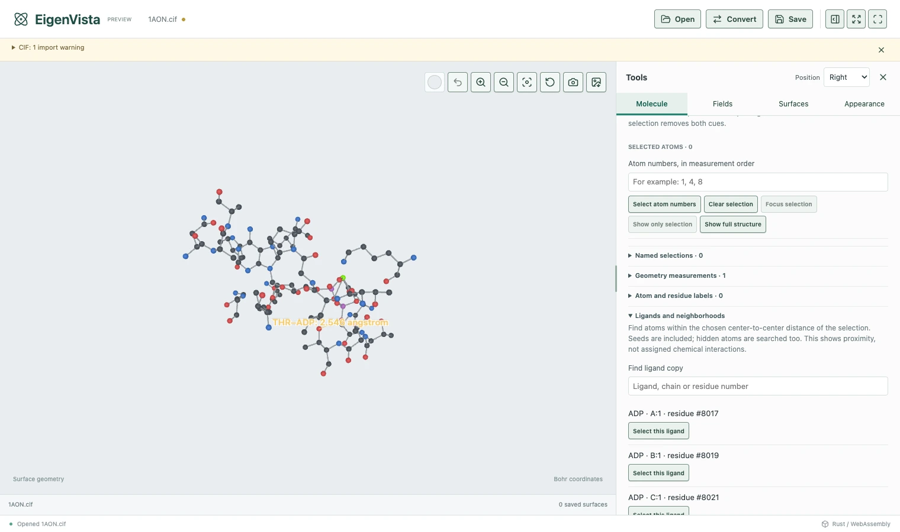

# Inspect a deposited ligand neighborhood with an agent

Select one of seven ADP copies in the linked 1AON mmCIF. Use the agent to resolve source identities, run two versions of the same radius search, and save a reproducible contact measurement. Start a connector-enabled EigenVista 0.10.6 session and give your agent the session note path. [Set up EigenVista](../../setup.md).

<figure class="tutorial-media">
  <video data-kind="workflow" controls playsinline preload="none" width="1600" height="900"
    aria-label="ADP neighborhood in the GUI and with an AI connector"
    poster="../../../assets/media/chemistry/stills/ligand-residue-controls.webp">
    <source src="../../../assets/media/chemistry/ligand-neighborhood.mp4" type="video/mp4">
    <track kind="captions" src="../../../assets/media/chemistry/ligand-neighborhood.vtt" srclang="en" label="English" default>
    <track kind="chapters" src="../../../assets/media/chemistry/ligand-neighborhood-chapters.vtt" srclang="en" label="Chapters">
  </video>
  <figcaption>Follow the GUI selection, then see the agent's request and the measured contact.</figcaption>
</figure>

## Download the result

The figure isolates ADP A:1 and its whole-residue neighborhood. The yellow monitor marks the **2.546 Å** center-to-center distance between THR A:91 OG1 and ADP A:1 O2B. Download the [annotated PNG](../../assets/media/chemistry/results/1aon-adp-a1.png){: download="1aon-adp-a1.png" } and the [measurement CSV](../../assets/media/chemistry/results/1aon-adp-a1.csv){: download="1aon-adp-a1.csv" }. Both are exports from the released desktop app.

## Run matched neighborhood queries

> Use my authorized EigenVista session and its approved input and results folders. Open the sample at https://uvar-apps.github.io/eigenvista/downloads/1AON.cif from Inputs, downloading it there if needed. Preserve any unsaved work. List the deposited ADP copies. Resolve ADP author chain A residue 1, mmCIF label chain W, using the imported chain and residue IDs. Use all atoms of this one ligand as seeds. Make and save two 4.0 angstrom neighborhoods, one for matching atom centers and one expanded to complete residues. Start both from the original ligand seeds. Wait for both jobs, then report the source identity, atom counts, and the complete residue count from accepted app results. Explain why whole-residue membership can include atoms outside the cutoff.

For the linked fixture, there are **27** seed atoms, **74** atom-center hits and **154** atoms after whole-residue expansion across **21** residues. Those totals include the ADP. The agent should bind to the selected file's IDs and check counts before interpreting any difference. [RCSB PDB 1AON](https://www.rcsb.org/structure/1AON).

*The app shows the focused neighborhood and the saved contact monitor after the controller accepts both operations.*

<figure class="tutorial-media">
  <video controls playsinline preload="none" width="1280" height="720" poster="../../../assets/media/concepts/ligand-expansion.webp" data-kind="concept" aria-label="Atom cutoff and whole-residue expansion">
    <source src="../../../assets/media/concepts/ligand-expansion.mp4" type="video/mp4">
    <track kind="captions" src="../../../assets/media/concepts/ligand-expansion.vtt" srclang="en" label="English" default>
  </video>
  <figcaption>Both searches start from the same ADP copy. The schematic shows how 74 atom-center hits expand to 154 atoms when complete residues are included.</figcaption>
</figure>

## Measure one identified pair and export

> In the same source, resolve THR author chain A residue 91 atom OG1 and ADP author chain A residue 1, label chain W, atom O2B. Add an always-visible distance monitor using the resolved atoms, confirm the reported value, and label the ADP residue. In Ball and stick, show and focus the named complete-residue neighborhood. Clear transient selection markers while keeping the isolated view and export a new 1aon-adp-a1.png. Save the measurement CSV and the annotated native file under new filenames in Results. Report the two identity records, the distance in angstroms, the selection names, filenames, and PNG dimensions. Describe the observation as geometric proximity.

Expect about **2.546 Å** for the specified pair. The corresponding zero-based indices are **657** and **58677** in the linked file. These are checkpoints only. An agent uses `structure.list`, `residues.list`, and `atoms.list` to discover those IDs, `selection.neighborhood` to compute each set, and `measure.list` to read back the saved distance. `selection.list` and its paginated member queries let it audit the named sets. [Connector reference](https://uvar-apps.github.io/eigenvista/downloads/eigenvista-control/reference.md).

[Follow the same workflow in the GUI](ligand-neighborhood-gui.md) · [Back to the chemistry agent tour](../agent.md)
