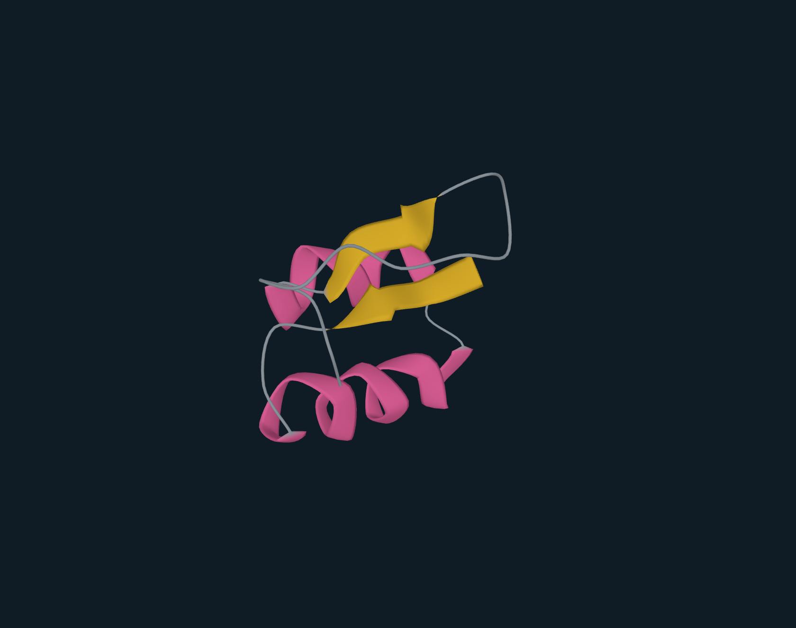
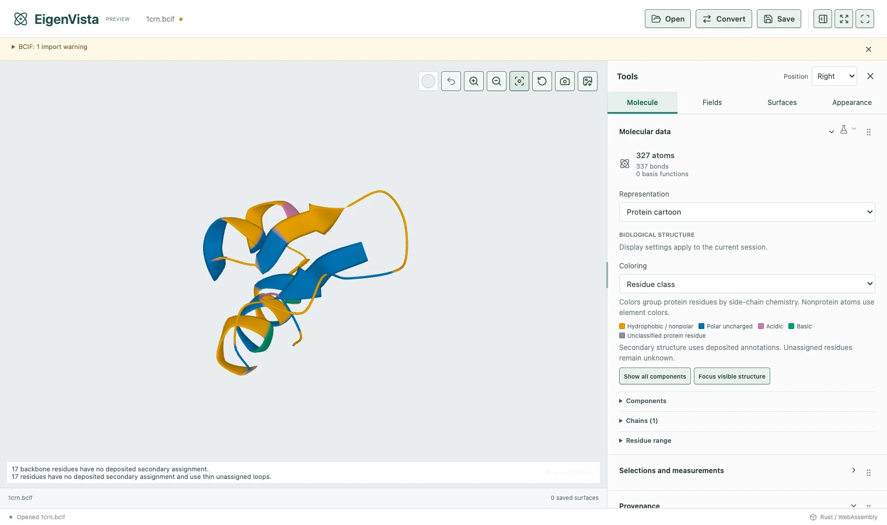

# Read a protein fold in the GUI

Compare the same crambin fold at two levels of detail. Read the deposited secondary structure first, then see which residue classes occupy the same backbone. Use EigenVista 0.10.6 and [download 1CRN as mmCIF](https://files.rcsb.org/download/1CRN.cif) or [BinaryCIF](https://models.rcsb.org/1crn.bcif). [Set up EigenVista](../../setup.md).

<figure class="tutorial-media">
  <video data-kind="workflow" controls playsinline preload="none" width="1600" height="900"
    aria-label="Two ways to inspect the 1CRN fold" poster="../../../assets/media/chemistry/stills/protein-secondary-controls.webp">
    <source src="../../../assets/media/chemistry/protein-cartoon.mp4" type="video/mp4">
    <track kind="captions" src="../../../assets/media/chemistry/protein-cartoon.vtt" srclang="en" label="English" default>
    <track kind="chapters" src="../../../assets/media/chemistry/protein-cartoon-chapters.vtt" srclang="en" label="Chapters">
  </video>
  <figcaption>Change the representation and coloring in the GUI, then see the matched figures exported by the agent.</figcaption>
</figure>

## Download the result

Download [secondary-structure PNG](../../assets/media/chemistry/results/1crn-secondary.png){: download="1crn-secondary.png" } and [residue-class PNG](../../assets/media/chemistry/results/1crn-residue-class.png){: download="1crn-residue-class.png" }. The released app exported both views from the same camera. Use the first to locate helices and strand arrows, then use the second to compare residue classes along those regions.

## Build comparable views

1. Open the source and check **Molecule → Molecular data**. The upstream text and binary fixtures both resolve to **327 selected atoms**, **46 residues**, and **one chain**, label **A**, author **A**. If your counts differ, check which file and entry revision you opened. [Upstream fixture record](https://github.com/uvar-apps/eigenvista/tree/v0.10.6/fixtures/bcif).
2. Choose **Protein backbone trace** and use **Fit scene**. Switch to **Protein cartoon** at the same camera angle. The trace follows the backbone, while the cartoon turns assigned sheets into arrows and distinguishes helices and connecting loops. **Protein smooth tube** and **Protein ribbon** give two more views of the same data.
3. Under **Biological structure → Coloring**, choose **Secondary structure**. Orbit until you see both helices and strand arrows, then export `1crn-secondary.png` with the scene toolbar. In the deposited annotations used by the fixture, helices span **7–19** and **23–30**, and sheet strands span **1–4** and **32–35**. The other 17 residues have unknown assignments in the viewer. [Source qualification](https://github.com/uvar-apps/eigenvista/blob/v0.10.6/app/tests/structure-controls.spec.ts).
4. Keeping the same camera and **Protein cartoon** representation, switch coloring to **Residue class** and export `1crn-residue-class.png`. Use the legend to compare nonpolar, polar uncharged, acidic, and basic residues. This scheme describes residue identity, including on previously gray connecting loops.

*Use the Molecular data legend to connect the colors to residue classes before exporting.*

## Focus on one annotated region

Expand **Residue range** inside **Biological structure**. Choose chain **A**, set **First residue** to `ILE 7` and **Last residue** to `PRO 19`, then choose **Show residue range**. Use **Focus visible structure** and switch to **Ball and stick** to see side chains around this helix. The range reports **13 selected residues**. Choose **Clear residue range** or **Show all components** and **Fit scene** when finished.

Save a new `1crn-fold.eigenvista` with **Protein cartoon** as the global representation. Reopen the file to confirm that the representation and biological identities persist. Keep the paired PNGs and record the camera, color modes, and range separately to reconstruct those views.

Crambin is a small deposited plant protein. The app uses the annotations present in the input, and gaps or ambiguous backbone segments can interrupt the drawing. [RCSB PDB 1CRN](https://www.rcsb.org/structure/1CRN), [EigenVista biological structure reference](https://uvar-apps.github.io/eigenvista/reference-structures.html).

[Use a connected agent for the same workflow](protein-cartoon-agent.md) · [Back to the chemistry GUI tour](../gui.md)
