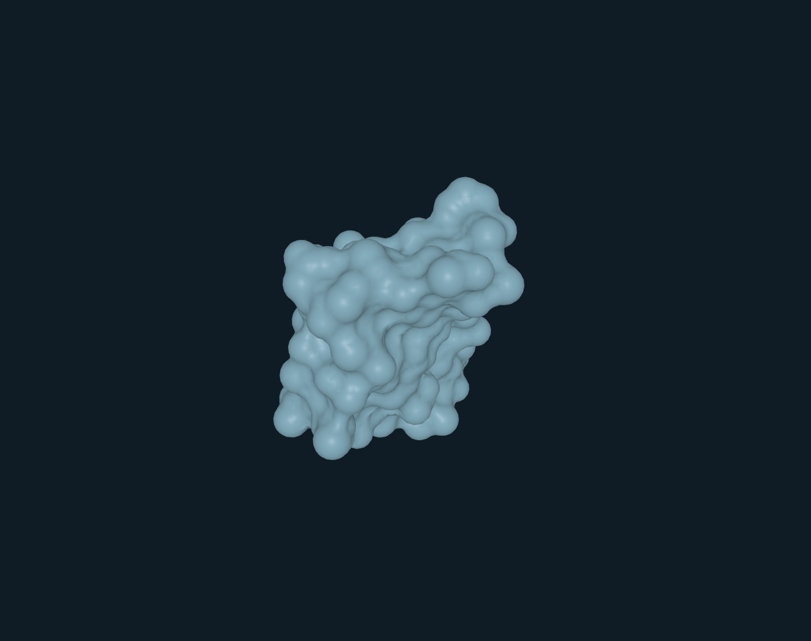
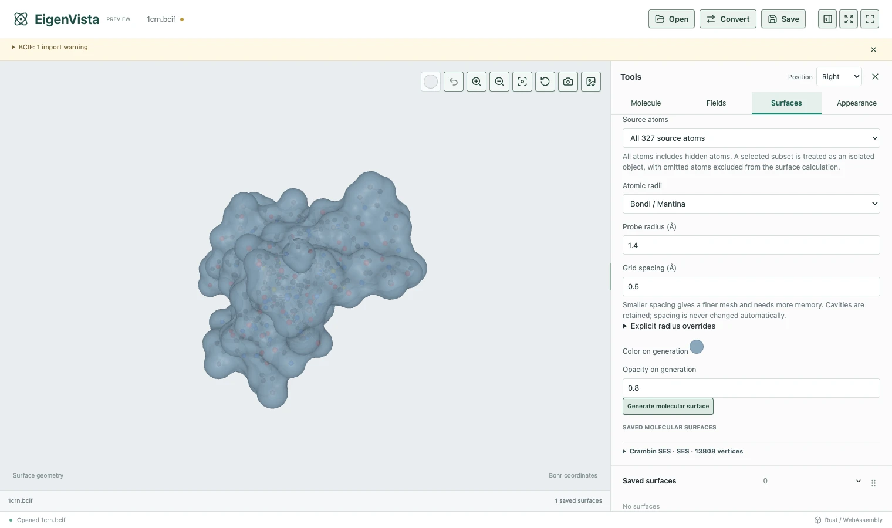

# Compare SES and SAS in the GUI

Use crambin to compare two meanings of molecular shape at fixed atom radii, probe size, and spacing. Open [1CRN mmCIF](https://files.rcsb.org/download/1CRN.cif) or [BinaryCIF](https://models.rcsb.org/1crn.bcif) in EigenVista 0.10.6. [Set up EigenVista](../../setup.md).

<figure class="tutorial-media">
  <video data-kind="workflow" controls playsinline preload="none" width="1600" height="900"
    aria-label="Generate and compare crambin solvent surfaces" poster="../../../assets/media/chemistry/stills/solvent-ses-controls.webp">
    <source src="../../../assets/media/chemistry/solvent-surfaces.mp4" type="video/mp4">
    <track kind="captions" src="../../../assets/media/chemistry/solvent-surfaces.vtt" srclang="en" label="English" default>
    <track kind="chapters" src="../../../assets/media/chemistry/solvent-surfaces-chapters.vtt" srclang="en" label="Chapters">
  </video>
  <figcaption>Follow the probe and grid controls and compare the two exported molecular shapes.</figcaption>
</figure>

## Download the result

Download [solvent-excluded surface PNG](../../assets/media/chemistry/results/1crn-ses.png){: download="1crn-ses.png" } and [solvent-accessible surface PNG](../../assets/media/chemistry/results/1crn-sas.png){: download="1crn-sas.png" }. Compare the two figures at their shared camera. The SAS follows the probe-center boundary and extends outward. The SES follows the boundary swept by the probe.

## Generate two meshes from the same source

1. Confirm **327 selected atoms** and choose **Ball and stick**. Clear any custom shader to make the first comparison with built-in materials. In **Surfaces → Molecular surfaces**, choose **Create a new surface**, and name it `Crambin SES`.
2. Set **Surface type** to **Solvent excluded (SES)**, **Source atoms** to **All 327 source atoms**, and **Atomic radii** to **Bondi / Mantina**. Use a **1.4 Å** probe and **0.5 Å** grid spacing. Leave radius overrides empty. Choose **Generate molecular surface** and wait for completion.
3. Choose **Create a new surface** again and name it `Crambin SAS`. Select **Solvent accessible (SAS)** and repeat the same source, radii, probe and spacing. In **Saved molecular surfaces**, expand both entries and verify the settings. For the linked structure and these parameters, expect **27,608 SES triangles** and **34,724 SAS triangles**. Regenerating an existing entry replaces its mesh after a successful calculation.
4. Make both surfaces visible, **Fit scene** once, then show only SES and export a PNG. Show only SAS and export a second PNG without moving the camera. Set the same color and opacity for both surfaces. SES follows the molecular boundary swept by the probe, including reentrant regions. SAS follows the path of the probe's center and offsets the accessible envelope.

*Check the source atoms, probe, and spacing before generating the second surface.*

<figure class="tutorial-media">
  <video controls playsinline preload="none" width="1280" height="720" poster="../../../assets/media/concepts/solvent-surfaces.webp" data-kind="concept" aria-label="Solvent-excluded and solvent-accessible surfaces">
    <source src="../../../assets/media/concepts/solvent-surfaces.mp4" type="video/mp4">
    <track kind="captions" src="../../../assets/media/concepts/solvent-surfaces.vtt" srclang="en" label="English" default>
  </video>
  <figcaption>This cross-section follows the same solvent probe along the SES boundary and shows the SAS traced by its center.</figcaption>
</figure>

## Separate geometry from presentation

At **100% opacity** and with built-in shading, enable **Appearance → Appearance → Molecular surface ambient occlusion** for a second SES image. Compare the two SES PNGs. The shading changes the depth cues while the saved mesh and generation settings stay the same. The separate atom/bond AO switch controls the atomic framework. Leave the camera fixed and keep the original SES and SAS PNGs as the geometric comparison.

An isolated surface from **Current selection** or **Named selection** is computed from those atoms alone. Hidden atoms still count if **All 327 source atoms** is selected. Use this distinction when studying a region on a larger complex. Reducing the spacing samples finer geometry and uses more memory. On failure, keep the accepted result and retry with an explicitly changed spacing or subset if the comparison calls for it.

Save `1crn-solvent-shapes.eigenvista` and reopen it. Verify that both cached meshes and their settings are available. Keep the camera, AO, and shader choices with the PNGs as presentation settings. SES and SAS represent geometry derived from coordinates and radii. Density or electrostatic-potential maps require a separate field or wavefunction input.

[RCSB PDB 1CRN](https://www.rcsb.org/structure/1CRN) · [EigenVista molecular surface reference](https://uvar-apps.github.io/eigenvista/reference-inspection.html#shape)

[Use a connected agent for the same workflow](solvent-surfaces-agent.md) · [Back to the chemistry GUI tour](../gui.md)
