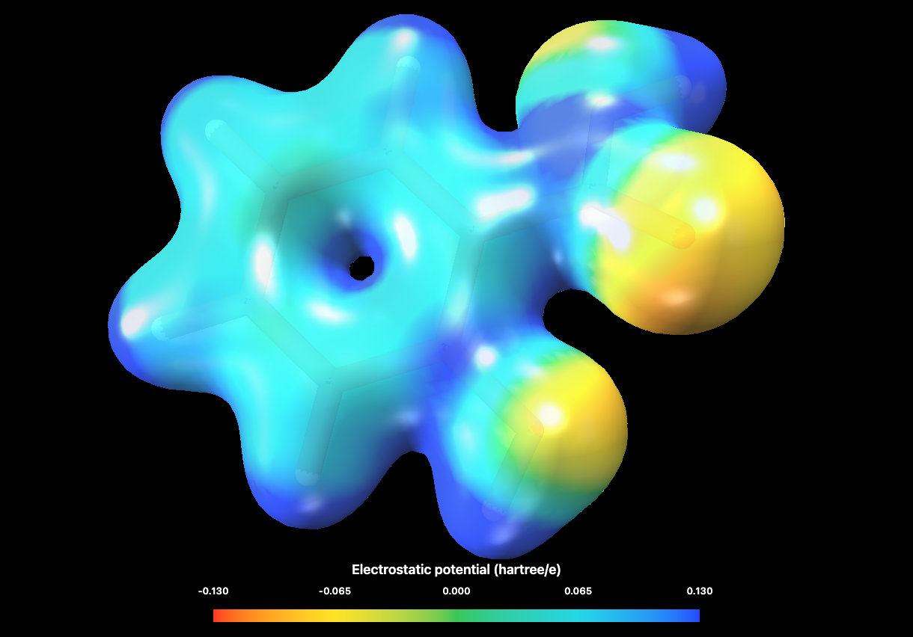

---
hide:
  - navigation
  - toc
---

<section class="education-hero" markdown="1">

# EigenVista Education

Explore molecular orbitals, inspect protein structures, and produce figures and numerical results you can check. Follow the desktop controls or work through the same examples with a local coding agent.

[Choose a tutorial](#start-with-a-tour){ .md-button .md-button--primary }
[Set up EigenVista](setup.md){ .md-button }

<figure class="education-hero-figure" markdown="1">

<figcaption markdown="1">Electrostatic potential mapped onto the electron-density surface of salicylic acid. [EigenVista Gallery](https://uvar-apps.github.io/eigenvista/gallery.html#salicylic-acid).</figcaption>
</figure>

</section>

## Start with a tour

<section class="education-track" markdown="1">

### Quantum chemistry

Open calculation outputs, compare orbital phases and density, sample a field, and export scientific results.

- [Quantum chemistry GUI tour](quantum/gui.md)
- [Quantum chemistry AI connector tour](quantum/agent.md)

</section>

<section class="education-track" markdown="1">

### Chemistry and biomolecules

Navigate molecular and protein structures, isolate components, measure local geometry, and compare molecular surfaces.

- [Chemistry and biomolecules GUI tour](chemistry/gui.md)
- [Chemistry and biomolecules AI connector tour](chemistry/agent.md)

</section>

## Work through a research task

Each workflow supplies an input, a sequence to follow, and a result to check. Choose the interface you want to use.

<section markdown="1">

### Quantum chemistry workflows

| Research task | Desktop | Agent |
| --- | --- | --- |
| Compare the HOMO and LUMO | [GUI](quantum/workflows/frontier-orbitals-gui.md){ aria-label="Compare the HOMO and LUMO in the GUI" } | [AI connector](quantum/workflows/frontier-orbitals-agent.md){ aria-label="Compare the HOMO and LUMO with an agent" } |
| Sample a quantitative cube field | [GUI](quantum/workflows/quantitative-cube-gui.md){ aria-label="Sample a quantitative cube field in the GUI" } | [AI connector](quantum/workflows/quantitative-cube-agent.md){ aria-label="Sample a quantitative cube field with an agent" } |
| Map electrostatic potential | [GUI](quantum/workflows/electrostatic-potential-gui.md){ aria-label="Map electrostatic potential in the GUI" } | [AI connector](quantum/workflows/electrostatic-potential-agent.md){ aria-label="Map electrostatic potential with an agent" } |
| Measure molecular geometry | [GUI](quantum/workflows/geometry-gui.md){ aria-label="Measure molecular geometry in the GUI" } | [AI connector](quantum/workflows/geometry-agent.md){ aria-label="Measure molecular geometry with an agent" } |

</section>

<section markdown="1">

### Chemistry and biomolecule workflows

| Research task | Desktop | Agent |
| --- | --- | --- |
| Inspect a protein fold and residue coloring | [GUI](chemistry/workflows/protein-cartoon-gui.md){ aria-label="Inspect a protein fold and residue coloring in the GUI" } | [AI connector](chemistry/workflows/protein-cartoon-agent.md){ aria-label="Inspect a protein fold and residue coloring with an agent" } |
| Find the neighbors of one ligand copy | [GUI](chemistry/workflows/ligand-neighborhood-gui.md){ aria-label="Find the neighbors of one ligand copy in the GUI" } | [AI connector](chemistry/workflows/ligand-neighborhood-agent.md){ aria-label="Find the neighbors of one ligand copy with an agent" } |
| Compare solvent-excluded and solvent-accessible surfaces | [GUI](chemistry/workflows/solvent-surfaces-gui.md){ aria-label="Compare molecular surfaces in the GUI" } | [AI connector](chemistry/workflows/solvent-surfaces-agent.md){ aria-label="Compare molecular surfaces with an agent" } |
| Measure local coordination geometry | [GUI](chemistry/workflows/coordination-geometry-gui.md){ aria-label="Measure local coordination geometry in the GUI" } | [AI connector](chemistry/workflows/coordination-geometry-agent.md){ aria-label="Measure local coordination geometry with an agent" } |

</section>

## Application reference

The lessons use EigenVista 0.10.6. For file-format profiles and the full control reference, see the [EigenVista manual](https://uvar-apps.github.io/eigenvista/reference.html), [AI connector guide](https://uvar-apps.github.io/eigenvista/ai-guide.html), and [release notes](https://github.com/uvar-apps/eigenvista/releases/tag/v0.10.6).

## License

The original tutorials and teaching examples are available under **Creative Commons Attribution 4.0 International**. When reusing a lesson, credit **EigenVista Education**, link to the original and the license, and indicate changes. [CC BY 4.0](https://creativecommons.org/licenses/by/4.0/).

Credited upstream figures and linked datasets carry their source terms. The salicylic acid figure is distributed with the EigenVista GPL-2.0-or-later notice. [Capture provenance](https://uvar-apps.github.io/eigenvista/assets/media/provenance.json) · [Upstream license](assets/eigenvista-license.txt).
