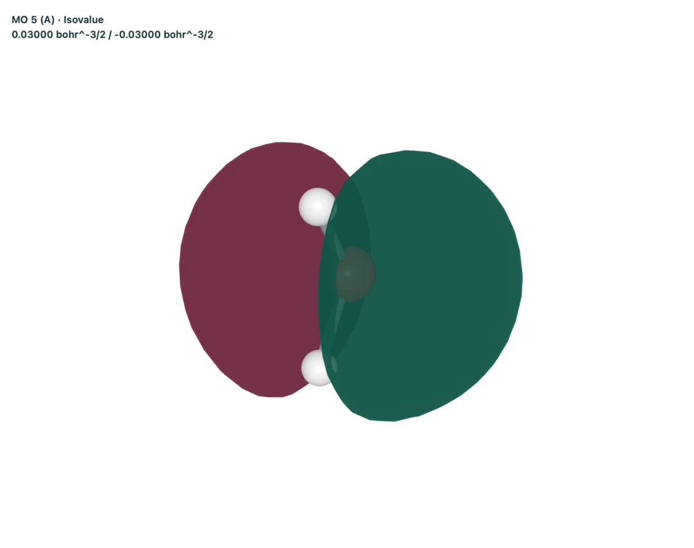

# Quantum chemistry with an agent

Use an external coding agent to operate your installed EigenVista 0.10.6 window. The prompts below produce a signed water orbital figure, a numerical profile and a native molecular document. Run them in order, reviewing each result before giving the next prompt. [Set up EigenVista](../setup.md) · [GUI version](gui.md)

<figure class="tutorial-media">
  <video controls playsinline preload="none" width="1600" height="900" poster="../../assets/media/quantum/water-homo.webp" data-kind="tour" aria-label="Quantum chemistry AI connector tour">
    <source src="../../assets/media/quantum/tour-agent.mp4" type="video/mp4">
    <track kind="captions" src="../../assets/media/quantum/tour-agent.vtt" srclang="en" label="English" default>
    <track kind="chapters" src="../../assets/media/quantum/tour-agent-chapters.vtt" srclang="en" label="Chapters">
  </video>
  <figcaption>Narrated walkthrough showing example prompts, EigenVista states that match the requests, and actual exports from the packaged 0.10.6 connector.</figcaption>
</figure>

[Read the tour transcript](../assets/media/quantum/tour-agent-transcript.txt).

## 1. Connect and verify the input

Start a connector-enabled session and give your agent the nonsecret session note. Use the approved input and Results folders from that note. The agent reads the portable connector instructions and uses the bundled helper from the same installed package. [Official connector guide](https://uvar-apps.github.io/eigenvista/ai-guide.html)

```text
Use the EigenVista session I just identified. Read the packaged agent
instructions and check the live capabilities and window state. Preserve any
unsaved document in Results under a fresh name before opening another input.
Open water.molden from my approved input folder. If it is absent, download it
there from https://uvar-apps.github.io/eigenvista/downloads/water.molden.
Confirm the atom, basis-function and orbital counts. Read all
needed orbital metadata and report the frontier orbital IDs, occupations and
energies with their units. For this closed-shell example identify the highest
occupied and lowest unoccupied orbitals by energy.
```

Expect **3 atoms**, **24 basis functions** and **24 spatial orbitals**. The HOMO is **MO 5**, with occupation **2** and energy approximately **−0.493063 hartree**. The LUMO is **MO 6**, with occupation **0** and energy approximately **+0.185460 hartree**. This is RHF/cc-pVDZ water. Report other spin or occupation cases according to their source metadata. [Calculation provenance](https://github.com/uvar-apps/eigenvista/blob/v0.10.6/fixtures/molden/README.md)

## 2. Compare previews and export a mesh figure

```text
Show the water HOMO in sampled raycast preview at 64 points per axis and an
isovalue magnitude of 0.03 bohr^-3/2. Use ball and stick, clear any previous
surface shader and remember the camera. Try volume preview with the same field,
grid and camera, then verify the preview created no saved meshes. Generate the
HOMO's signed isosurface meshes at the same isovalue and resolution. Wait for
successful completion, report the signed levels and triangle counts, restore
the camera and show the field rendering key. Export a transparent PNG into
Results using a fresh name and inspect the actual image.
```

The output should have distinct signs at **−0.03** and **+0.03 bohr⁻³ᐟ²**. Both colors encode phase. A separately rendered total-density surface uses electrons/bohr³ and has only a positive level for a nonnegative density. Try the LUMO later with the same camera, isovalue and resolution for a like-for-like comparison.



## 3. Measure, sample and preserve the work

```text
Find the oxygen and first hydrogen in the loaded source atom table and tell me
their displayed numbers. Save a visible O–H distance monitor in that order.
Using the same ordered atoms as endpoints, sample the HOMO along the bond at
65 points including both ends. Report the profile length in angstroms and the
source field units. Export fresh measurement and analysis CSV files into
Results and check the rows, endpoints, statuses and units. Save a new
water-quantum-tour.eigenvista, reopen it after the save completes, and verify
the measurement, profile and signed meshes are still present. Report the file
paths and any session settings I need to reapply to reproduce the figure.
```

The monitor distance and profile length should agree at approximately **0.9580 Å** because they use the same atomic centers. Connector atom indices start at zero and GUI atom numbers at one. Scientific record definitions, cached analyses and meshes persist in the native document. Keep the PNG and the camera, background, palette, AO and shader settings alongside it. [Persistence reference](https://uvar-apps.github.io/eigenvista/reference.html#persistence)

Compare your exports with these worked outputs from the released connector. [Download signed HOMO PNG](../assets/media/quantum/results/water-homo.png){ download } · [Download the O–H measurement CSV](../assets/media/quantum/results/water-measurements.csv){ download } · [Download the HOMO profile CSV](../assets/media/quantum/results/water-homo-profile.csv){ download }.

## 4. Ask for the next operation by its outcome

```text
Keep the saved water tour intact. In the current window, hide the MO meshes
and generate a total electron-density mesh with an isovalue of 0.05 electrons
per cubic bohr and 48 samples per grid axis. Then generate a solvent-accessible
surface for all three source atoms using Bondi / Mantina radii, a 1.4 Å probe
and 0.5 Å spacing. Show one shell at a time. Confirm the density has one
positive level, report the SAS settings and warnings, and explain what each
surface measures. If you save this extension, give it a fresh native path.
```

| To do this | Ask your agent to do this |
| --- | --- |
| Compare fields | Read the supplied orbital, density or grid metadata. Match isovalue, spatial resolution, camera and colors wherever the scalar quantity and unit are comparable. |
| Sample numerical values | Make a point probe, a plane with a fixed color scale and contours, or a profile along two atoms or coordinates. Export and check CSV with units and statuses. |
| Inspect molecular geometry | Resolve source atoms, preserve pick order, measure a distance, angle or signed torsion, and save named selections and labels. |
| Inspect coordinate-derived shape | Generate SES or SAS with a named radii table, probe size and grid spacing in Å. Report the exact included atoms, warnings and mesh counts. |
| Visualize electrostatic potential | Find the all-electron total density, generate one mapped shell and report the density level and potential scale separately. |
| Make figures | Set representation, palette, camera, background and shading, apply an available X-ray, clipping or vertex-colored Phong preset, and verify a PNG export. |

The agent can check the live capabilities and translate these requests into supported actions. It should read back the accepted settings and confirm the calculation finished before exporting. Use a fresh output path or grant explicit replacement for a specific existing result. For batch file conversion, ask the agent to use the installed converter. [Portable connector reference](https://uvar-apps.github.io/eigenvista/downloads/eigenvista-control/reference.md) · [Converter documentation](https://uvar-apps.github.io/eigenvista/reference-files.html)

## 5. Ask for progress, a cutaway, and converted copies

```text
Start a finer test mesh for the same field while keeping the saved result.
Report the job's current phase and elapsed time. If I ask to cancel, stop
only that job, then confirm which previously completed meshes are available.
```

```text
In the extension with the density and solvent-accessible shells, keep only
the density shell visible. Apply the surface clipping preset to that shell.
Change its x maximum to zero, export the cutaway PNG, and record the uniforms.
Clear the shader afterward if I want to return to the ordinary surface.
```

```text
Use the installed converter for approved water.molden and signed-affine.cube.
Write each result as a fresh native file under Results. Verify both outputs,
report any warnings per source file, and keep the active viewer document open.
```

## Practice on research tasks

- [Compare frontier orbitals with an agent](workflows/frontier-orbitals-agent.md)
- [Validate a cube slice and profile with an agent](workflows/quantitative-cube-agent.md)
- [Map potential onto a density surface with an agent](workflows/electrostatic-potential-agent.md)
- [Measure and annotate a geometry with an agent](workflows/geometry-agent.md)
