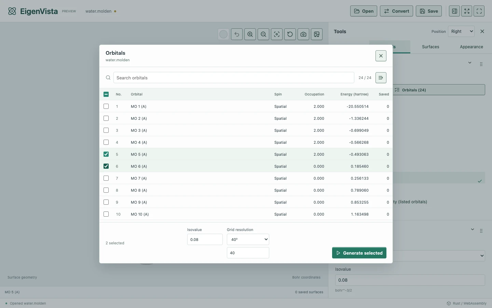
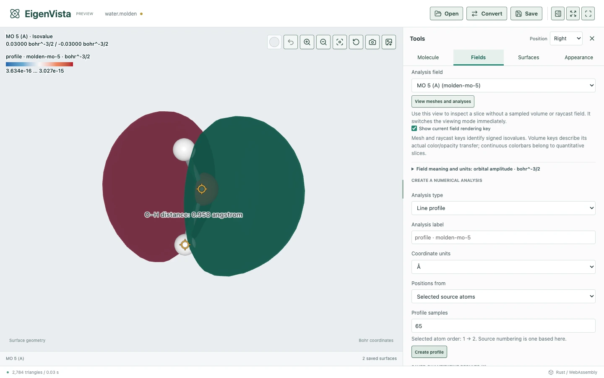
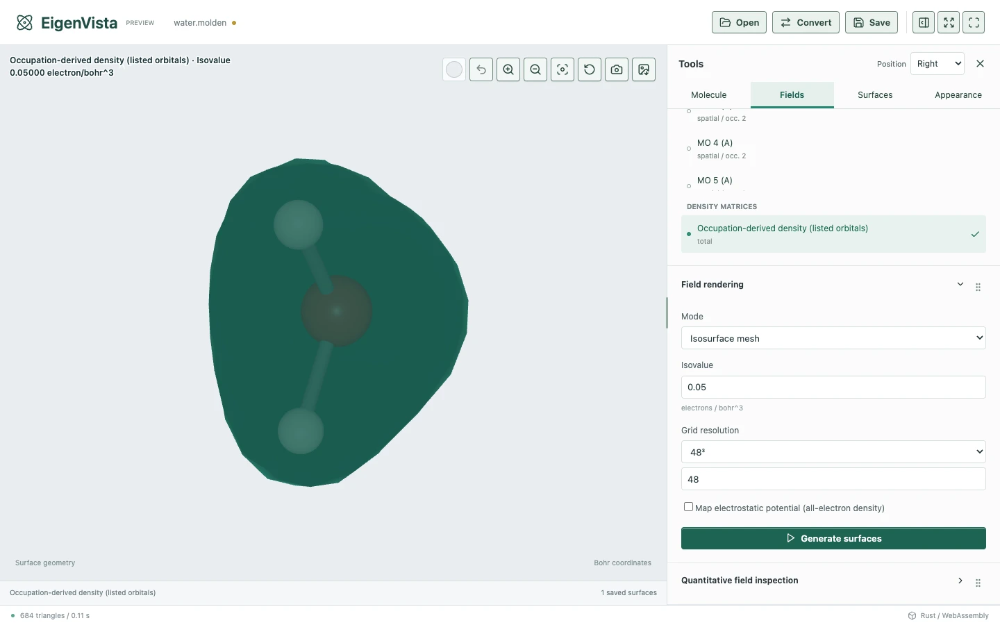
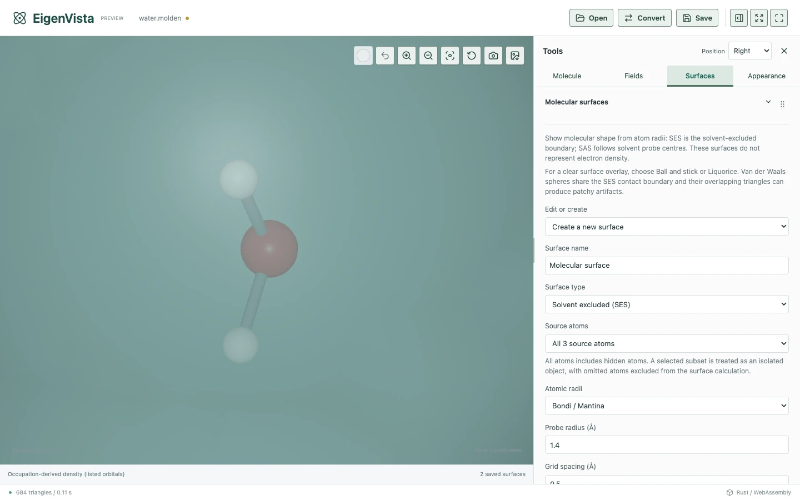
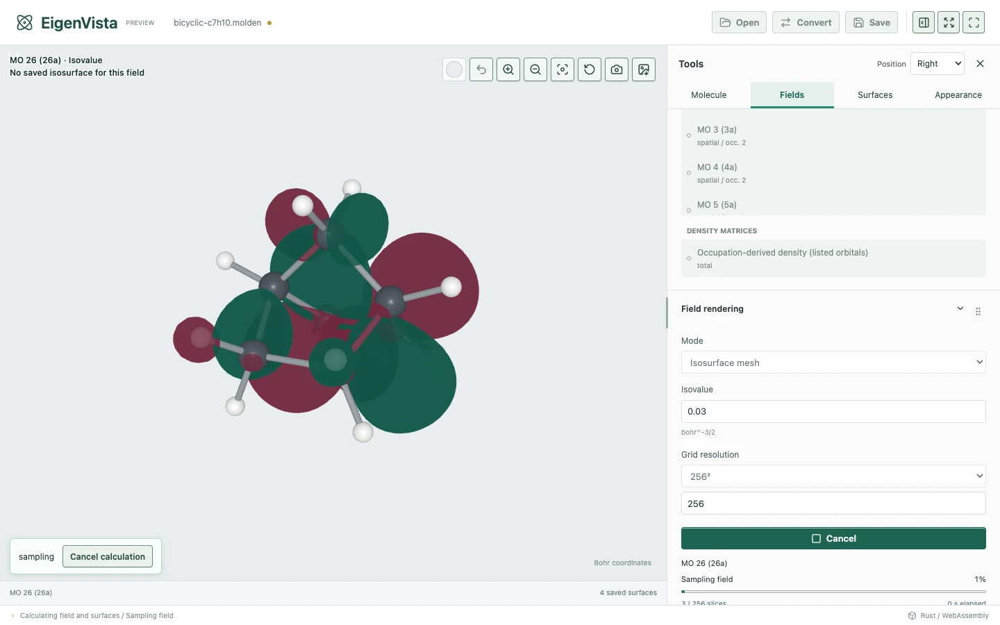
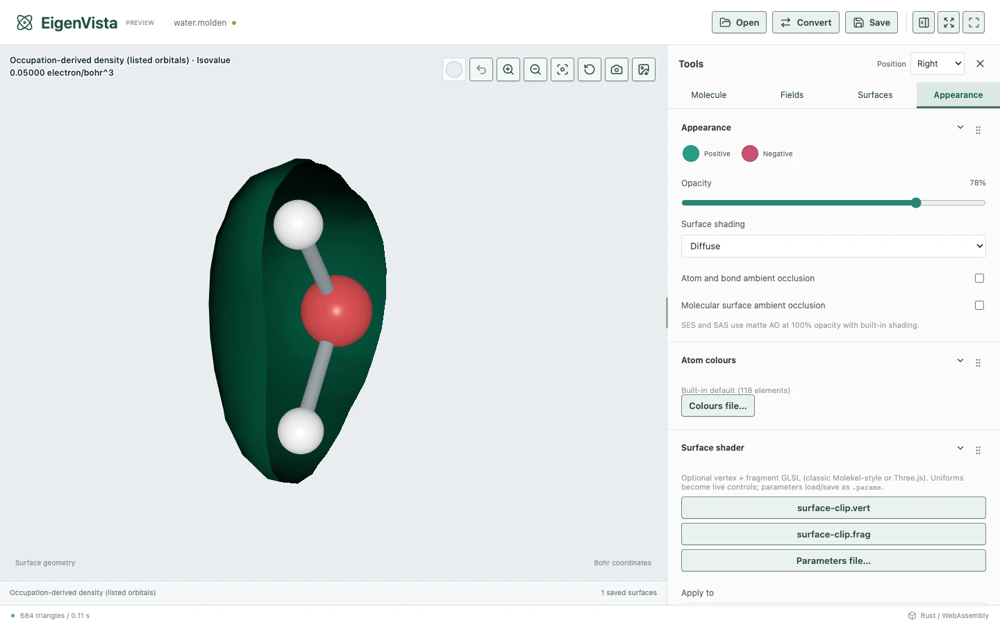

# Quantum chemistry with the GUI

Open a calculated water wavefunction, read its orbital metadata, and make three records of what you see in EigenVista 0.10.6. By the end you will have a signed orbital figure, a numerical profile and a native document you can reopen. [Set up EigenVista](../setup.md) · [Agent version](agent.md)

<figure class="tutorial-media">
  <video controls playsinline preload="none" width="1600" height="900" poster="../../assets/media/quantum/water-orbital-metadata.webp" data-kind="tour" aria-label="Quantum chemistry GUI tour">
    <source src="../../assets/media/quantum/tour-gui.mp4" type="video/mp4">
    <track kind="captions" src="../../assets/media/quantum/tour-gui.vtt" srclang="en" label="English" default>
    <track kind="chapters" src="../../assets/media/quantum/tour-gui-chapters.vtt" srclang="en" label="Chapters">
  </video>
  <figcaption>Narrated tour of the published EigenVista controls, from import and orbital metadata through meshes, numeric analysis, clipping, and conversion.</figcaption>
</figure>

[Read the tour transcript](../assets/media/quantum/tour-gui-transcript.txt).

## 1. Start with a calculated molecule

1. Download `water.molden` or use the copy in your package's `Examples` directory. Use the app's **Open** button. The file contains RHF/cc-pVDZ water with **3 atoms**, **24 basis functions** and **24 spatial orbitals**. In **Molecule → Molecular data**, check the counts and select **Ball and stick**. [Water Molden file](https://uvar-apps.github.io/eigenvista/downloads/water.molden) · [Calculation provenance](https://github.com/uvar-apps/eigenvista/blob/v0.10.6/fixtures/molden/README.md)
2. Read the import report and the **Provenance** widget. The viewer uses the supplied geometry, basis and orbital coefficients and infers display bonds. Record the original calculation and keep the input alongside the outputs.
3. Rotate by dragging, pan with right-drag or Ctrl-drag, and zoom by scrolling. **Fit scene** restores the default framing. Click an atom to check its number and coordinates. Use **Hide tools** or **Shift+T** to give the scene more space.

## 2. Inspect an orbital and keep its two signs

1. In **Fields → Quantum fields**, open **Orbitals (24)**. For this closed-shell calculation the highest-energy occupied orbital is **MO 5**, with occupation **2** and energy approximately **−0.493063 hartree**. The lowest-energy orbital with occupation zero is **MO 6**, at approximately **+0.185460 hartree**. Close the browser and choose MO 5 in the orbital field list.
2. In **Field rendering**, set **Isovalue** to **0.03** and **Grid resolution** to **64³**. Choose **Sampled raycast preview**, wait for sampling, then switch to **Volume preview**. Move the camera with either preview. **Sampling quality** changes sampling along display rays, while **Grid resolution** changes spatial samples.
3. Click **Generate surfaces** to keep the orbital as mesh geometry. Wait for completion and open **Surfaces → Saved surfaces**. Use each eye control to inspect the positive and negative meshes. The color signs refer to orbital amplitude ψ in bohr⁻³ᐟ². A global sign flip leaves the orbital's physical predictions unchanged.
4. Use **Appearance → Appearance** to set the two phase colors, opacity and surface shading. Under **Fields → Quantitative field inspection**, enable **Show current field rendering key** for the signed isovalue labels. Frame the molecule and save an opaque or transparent PNG with the viewport export buttons. [Orbital and field rendering reference](https://uvar-apps.github.io/eigenvista/reference-fields.html)

## 3. Measure the structure and sample the orbital

1. Open **Molecule → Selections and measurements**. Enter **1, 2** and choose **Select atom numbers**. Under **Geometry measurements**, choose **Distance**, label it `O–H distance` and use **Add measurement**. Expect approximately **0.9580 Å**. Export a measurement CSV if you want the coordinate-derived number with the figure.
2. Keep the ordered pair and open **Fields → Quantitative field inspection**. Choose MO 5 as **Analysis field**, then **Line profile**. Set **Positions from** to **Selected source atoms**. Set **Profile samples** to **65** and choose **Create profile**. The first and last samples are at the selected atom positions, and the distance axis is in Å.
3. Try **Point probe** on atom **1** or **Plane / contours** through the molecule. **Field meaning and units** identifies the quantity and source unit. Use **View meshes and analyses** to remove a sampled 3D preview while working with a plane. Hide saved meshes separately if needed.
4. Open **Numerical samples and provenance** and use **Export analysis CSV**. Verify the sample count, coordinate units and scalar units. Save `water-quantum-tour.eigenvista` after the analysis finishes. Reopen it and check that the measurement, accepted analysis and orbital meshes survived. Record the camera, background and any custom shader separately if you need to reproduce the image. [Quantitative inspection reference](https://uvar-apps.github.io/eigenvista/reference-inspection.html)

Open these worked exports to check the two signs, bond length, and profile columns. [Download signed HOMO PNG](../assets/media/quantum/results/water-homo.png){ download } · [Download the O–H measurement CSV](../assets/media/quantum/results/water-measurements.csv){ download } · [Download the HOMO profile CSV](../assets/media/quantum/results/water-homo-profile.csv){ download }.

## 4. Choose the right kind of field or surface

Use the saved tour document as your starting point and write a fresh copy for this extension.

1. Select the total electron density under **Fields → Quantum fields → Density matrices**. Generate a mesh at **0.05 electrons/bohr³** and **48³**. Hide the two MO meshes. The density has a single positive shell. Enable the rendering key to read the density level and unit. If it is already on, turn it off and back on to refresh it.
2. Hide the density mesh. In **Surfaces → Molecular surfaces**, generate a **Solvent accessible (SAS)** surface for all atoms using **Bondi / Mantina**, **1.4 Å** probe radius and **0.5 Å** grid spacing. Compare it with the density shell by switching their visibility. Each surface answers a different question about the same molecule.
3. Under **Appearance**, try an element palette to change the atomic display. On the saved SAS, set opacity to **1** and try **Molecular surface ambient occlusion** to see how recesses are shaded. Use the table below to continue with a different dataset or surface finish. [Molecular surfaces and appearance](https://uvar-apps.github.io/eigenvista/tutorials-molecular-surfaces.html)

| Goal | Where to work | What the result represents |
| --- | --- | --- |
| Compare several orbitals | **Fields → Quantum fields → Orbitals**, then **Generate selected** | Separate signed orbital meshes at a common resolution and isovalue. |
| Show the electron-density envelope | **Fields → Quantum fields → Density matrices** | The import's occupation-derived density, an occupation-weighted sum of squared listed orbitals in electrons/bohr³. Read warnings for incomplete orbital sets. |
| Display a producer-supplied scalar | **Open** a `.cube` or `.cub`, then choose the sampled field | Values on an affine grid. Use source provenance to establish the scalar quantity and unit. |
| Color a density shell with electrostatic potential | **Fields → Field rendering → Map electrostatic potential (all-electron density)** | A density isosurface colored by nuclear and electronic Coulomb potential from the supplied all-electron wavefunction. |
| Show molecular shape from coordinates | **Surfaces → Molecular surfaces** | SES or SAS from atomic centers, radii and a solvent probe. Try a 1.4 Å probe and 0.5 Å grid spacing for an initial small-molecule view. |
| Change scene presentation | **Appearance → Appearance**, **Atom colours** or **Surface shader** | Shading, opacity, element palettes and GLSL finishes. The clipping shader opens a visual window. A quantitative plane samples numerical values. |
| Convert a group of imports | **Convert files**, then **Convert** and **Save** on the completed rows | Native files with imported data. Generate surface meshes in the viewer as a separate operation. |

Molden support depends on the producer's basis conventions. Keep the original producer title for ORCA exports and check the supported profile before a larger batch. For shape-only work, Open accepts PDB, mmCIF, BinaryCIF and XYZ. [File and native-format reference](https://uvar-apps.github.io/eigenvista/reference-files.html) · [Molden documentation](https://github.com/uvar-apps/eigenvista/blob/v0.10.6/docs/molden-import.md)

## 5. Monitor, clip, and convert

- **Monitor a calculation.** Start a higher-resolution replacement for a field with existing meshes. Watch the phase and elapsed time. Use **Cancel** in Field rendering or **Cancel calculation** over the viewport while it is active. Check that the previous accepted meshes are still in Saved surfaces. Reopen or reload the saved result before trying again.
- **Open a window into a shell.** In **Appearance → Surface shader**, load `surface-clip.vert`, `surface-clip.frag`, and `surface-clip.params` from the package's `Shaders` folder. Target the density surface, choose **Apply shader**, and try `xmax = 0` to cut through the current molecular view. **Save parameters** preserves the uniform values for another session. **Clear shader** restores the ordinary surface. [Clipping controls](https://uvar-apps.github.io/eigenvista/surface-shaders.html).
- **Convert a batch.** Choose **Convert Files** in the top bar. Use **Add files** to queue `water.molden` and `signed-affine.cube`. Choose **Convert**, inspect both rows, then choose **Save** for each converted output you want. Keep source files with the results. [Conversion reference](https://uvar-apps.github.io/eigenvista/reference-files.html).

## Practice on research tasks

- [Compare frontier orbitals](workflows/frontier-orbitals-gui.md)
- [Validate a cube slice and profile](workflows/quantitative-cube-gui.md)
- [Map potential onto a density surface](workflows/electrostatic-potential-gui.md)
- [Measure and annotate a geometry](workflows/geometry-gui.md)
