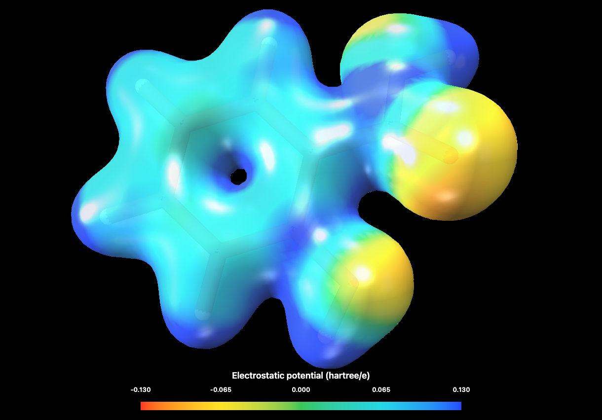

# Map electrostatic potential in the GUI

Make a salicylic acid total electron-density shell and color it by molecular electrostatic potential. Use the same shell to observe what changes when you adjust the color scale or the lighting. [Quantum GUI tour](../gui.md) · [Agent version](electrostatic-potential-agent.md)

The reference shell is drawn at **0.0248 electrons/bohr³**. Its colors cover **−0.130 to +0.130 hartree/e**, with the Phong shader's opacity set to **0.88**. [EigenVista Gallery](https://uvar-apps.github.io/eigenvista/gallery.html#salicylic-acid) · [Capture provenance](https://uvar-apps.github.io/eigenvista/assets/media/provenance.json)

## Check the calculation and prepare the shader

Use EigenVista **0.10.6** and `salicylic-acid-rhf.molden`, a **16-atom** all-electron RHF/6-31G(d) single-point calculation at a supplied PubChem conformer geometry. The example's provenance establishes the use of all electrons. For your own Molden input, check the original calculation for effective core potentials because the exchange file may omit that information. [Download the Molden example](https://uvar-apps.github.io/eigenvista/downloads/salicylic-acid-rhf.molden) · [Calculation provenance](https://uvar-apps.github.io/eigenvista/downloads/README-quantum-example.txt)

For the optional figure finish, use `surface-phong-vertex-color.vert`, `surface-phong-vertex-color.frag` and `Salicylic-Phong.params` from the package's `Shaders` folder. [Vertex shader](https://uvar-apps.github.io/eigenvista/downloads/shaders/surface-phong-vertex-color.vert) · [Fragment shader](https://uvar-apps.github.io/eigenvista/downloads/shaders/surface-phong-vertex-color.frag) · [Opacity preset](https://uvar-apps.github.io/eigenvista/downloads/shaders/Salicylic-Phong.params)

## Build and color the shell

1. Open the Molden file. Under **Molecule → Molecular data**, choose **Liquorice** to keep the framework visible through a translucent surface.
2. In **Fields → Quantum fields**, choose the total electron density from **Density matrices**. Under **Field rendering**, use **Isosurface mesh**, enter **0.0248 electrons/bohr³** for the isovalue, and set **Custom grid resolution** to **112**. Press Enter to commit the resolution.
3. Enable **Map electrostatic potential (all-electron density)** and click **Generate surfaces**. Wait for the mesh generation and potential-mapping stages to finish. The published example produces one mesh with **21,064 triangles** at these settings.
4. In **Surfaces → Saved surfaces**, keep **Show electrostatic potential** enabled and set **Color range ± (hartree/e)** to **0.130**. Press Enter. The scale runs from red at **−0.130** through green at zero to blue at **+0.130 hartree/e**.
5. Export a figure with built-in **Blinn-Phong** or **Diffuse** shading. For a second finish, open **Appearance → Surface shader** and load the vertex, fragment and parameter files. Under **Apply to**, target the density mesh, enable **Shader transparency**, and click **Apply shader**. Check the **0.88** opacity uniform. Export another PNG with the same camera and color range. [Upstream figure and settings](https://uvar-apps.github.io/eigenvista/tutorials-electrostatic-potential.html)

## Check which setting changes which result

| Setting | What you are changing |
| --- | --- |
| Density isovalue | The surface geometry. Regenerate the mesh to use a different density threshold. |
| Potential color range | Which colors represent the existing vertex samples. Values outside the range use the endpoint colors. |
| Shader and opacity | The appearance of the mapped shell and how much of its molecular framework you can see. |

The potential combines nuclear and electronic Coulomb terms evaluated for a positive test charge, with zero at infinity. Use the units from the legend when comparing values. Potential colors on this shell alone do not establish binding affinity or a reaction pathway.

Save `salicylic-acid-esp.eigenvista` and reopen it to check the mesh, mapping and range. The shader and camera belong to the session, so record their settings and retain the exported PNGs with the native file. Use matched density levels, color ranges and compatible calculation methods when comparing different molecules. [Field reference](https://uvar-apps.github.io/eigenvista/reference-fields.html)
