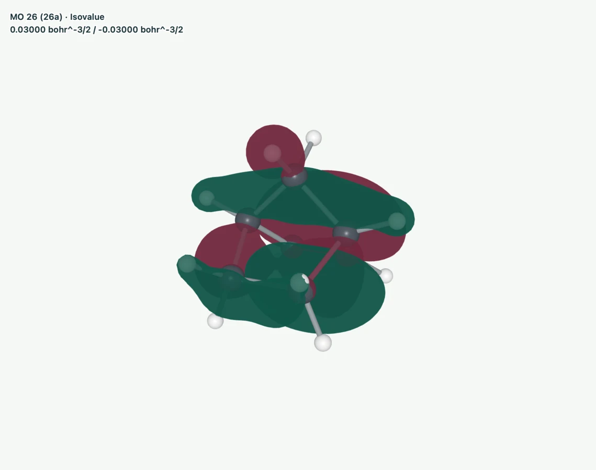
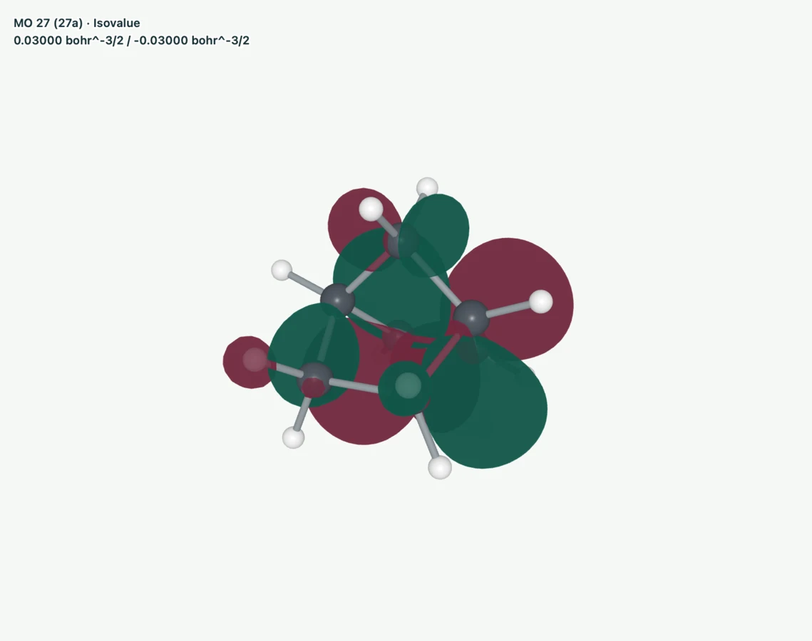

# Compare frontier orbitals with an agent

Make two matched views of the C₇H₁₀ frontier orbitals and a native file containing both signed mesh pairs. Use a connected EigenVista 0.10.6 session and run the prompts in order. [Set up EigenVista](../../setup.md) · [Quantum agent tour](../agent.md) · [GUI version](frontier-orbitals-gui.md)

<figure class="tutorial-media">
  <video controls playsinline preload="none" width="1600" height="900" poster="../../../assets/media/quantum/c7h10-homo-128.webp" data-kind="workflow" aria-label="Frontier orbital workflow video">
    <source src="../../../assets/media/quantum/frontier-orbitals.mp4" type="video/mp4">
    <track kind="captions" src="../../../assets/media/quantum/frontier-orbitals.vtt" srclang="en" label="English" default>
    <track kind="chapters" src="../../../assets/media/quantum/frontier-orbitals-chapters.vtt" srclang="en" label="Chapters">
  </video>
  <figcaption>Follow the AI connector chapter to see the prompt and its two native figure exports.</figcaption>
</figure>

## Resolve the orbitals

```text
Use my connected EigenVista window. Protect any unsaved work by saving it to a
new file in Results before opening another document. Open the approved
bicyclic-c7h10.molden example. If it is missing, download the official copy
from https://uvar-apps.github.io/eigenvista/downloads/bicyclic-c7h10.molden
into my approved input folder. Read all available orbital metadata by paging
as needed. Identify the highest-energy occupied orbital and lowest-energy
zero-occupation orbital. Report both IDs, labels, occupations and energies.
```

Expect **17 atoms**, **125 basis functions** and **118 orbitals**. The HOMO is **MO 26 (26a)** at about **−0.20945781 hartree** with occupation **2**. The LUMO is **MO 27 (27a)** at about **−0.02245212 hartree** with occupation **0**. The calculation's method and basis-set name are unstated in the input. [Data provenance](https://uvar-apps.github.io/eigenvista/downloads/README-quantum-example.txt)

## Generate and compare matched views

```text
Generate the HOMO and LUMO meshes together using a positive isovalue magnitude
of 0.03 bohr^-3/2 and 128 samples per grid axis. Wait for completion and read
the surfaces back. Report each returned field ID, signed isovalue and triangle
count. Clear any earlier shader, use ball and stick, and show the field key.
Choose one camera and framing that fit both orbitals. Keep the camera, viewport
size, background, sign colors and opacity fixed. Show only the HOMO's two
meshes and export c7h10-homo-128.png. Show only the LUMO's two meshes and
export c7h10-lumo-128.png. Before each export, select the corresponding field
and re-enable the rendering key to load its units. Use fresh paths in Results.
Inspect both PNGs and report the camera and appearance settings with the files.
Write a comparison CSV with one row per signed mesh. Include its orbital ID,
occupation, energy in hartree, signed isovalue, grid size and triangle count.
```

The response should identify **four meshes**, one positive and one negative for each field. A checked v0.10.6 run produced **9,324 / 9,412** positive / negative HOMO triangles and **9,144 / 9,132** positive / negative LUMO triangles. Use `camera.get` and `camera.set` when the same pose must survive scene changes. `surfaces.list` supplies actual signed levels, resolutions and triangle counts. [Connector reference](https://uvar-apps.github.io/eigenvista/downloads/eigenvista-control/reference.md)

### Worked results

<div class="tutorial-comparison" markdown="1">

[](../../assets/media/quantum/results/c7h10-homo-128.png)

[](../../assets/media/quantum/results/c7h10-lumo-128.png)

</div>

Compare your exports with this verified 0.10.6 run. The image dimensions match and each displays the two signed levels for its own field. [Download HOMO PNG](../../assets/media/quantum/results/c7h10-homo-128.png){ download } · [Download LUMO PNG](../../assets/media/quantum/results/c7h10-lumo-128.png){ download } · [Download comparison CSV](../../assets/media/quantum/results/c7h10-frontier-comparison.csv){ download }.

<figure class="tutorial-media">
  <video controls playsinline preload="none" width="1280" height="720" poster="../../../assets/media/concepts/orbital-phase.webp" data-kind="concept" aria-label="Orbital phase and density">
    <source src="../../../assets/media/concepts/orbital-phase.mp4" type="video/mp4">
    <track kind="captions" src="../../../assets/media/concepts/orbital-phase.vtt" srclang="en" label="English" default>
  </video>
  <figcaption>This schematic shows a global sign flip of ψ, the fixed nodal plane, and the unchanged nonnegative |ψ|².</figcaption>
</figure>

## Keep the result and assess the orbital comparison

```text
Save c7h10-frontier-128.eigenvista in Results at a fresh path and reopen it.
Verify all four signed meshes are available and report the output paths.
Compare where the two orbitals have large lobes and where the patterns differ
relative to the carbon framework. Discuss relative phase within each orbital,
allow for a global phase flip, and report the supplied orbital-energy gap in
hartree. Keep those statements separate from an excitation-energy assignment.
```

The energy difference is approximately **0.187006 hartree**. For a grid-sensitivity check, ask for a second native document and figure pair using **256³** with the same isovalue and presentation. The generation job replaces meshes for the chosen fields in the open document, so keep the 128³ native file before asking for finer meshes. Pause after the first export pair if you want to verify the comparability of the images yourself. [Upstream recorded connector example](https://uvar-apps.github.io/eigenvista/ai-tutorial-orbitals.html)
