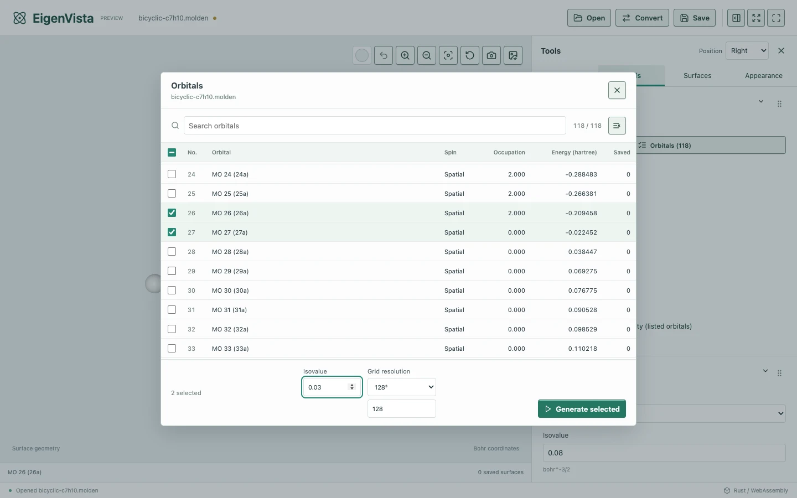
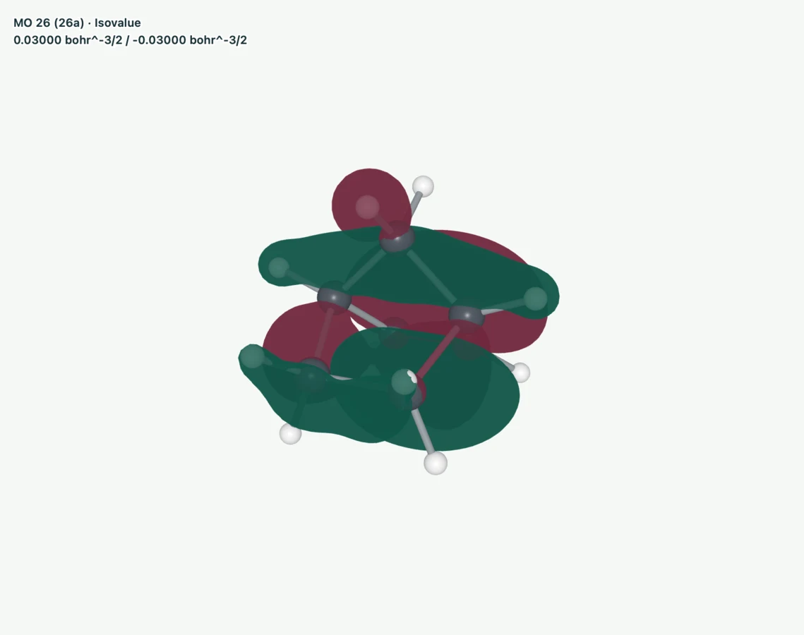
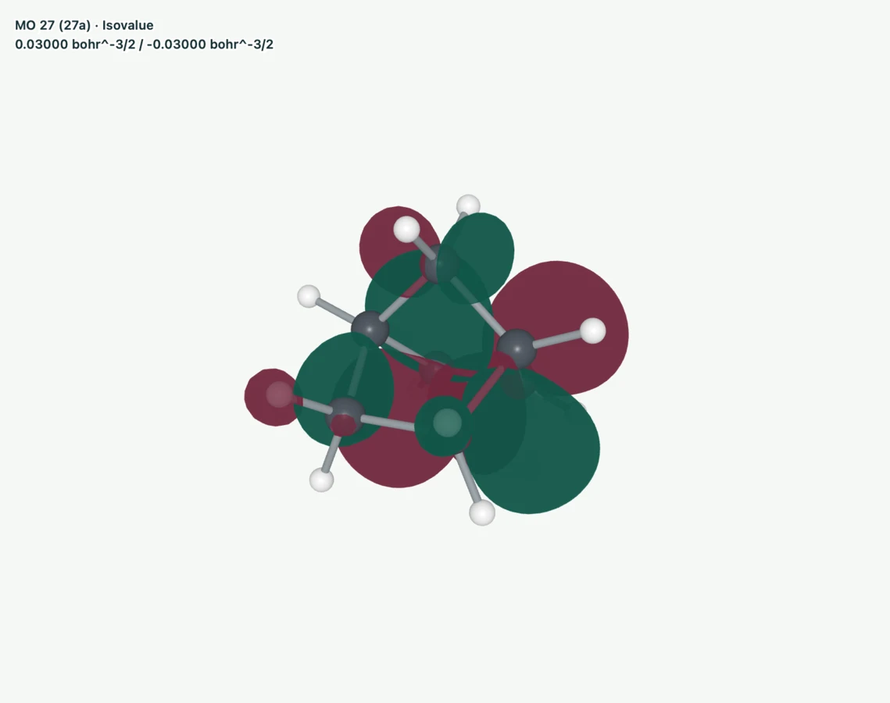

# Compare frontier orbitals in the GUI

Use one C₇H₁₀ calculation to compare the spatial extent and nodal patterns of the HOMO and LUMO. Make a paired figure with fixed sampling and presentation, and preserve both orbital meshes in one document. [Quantum GUI tour](../gui.md) · [Agent version](frontier-orbitals-agent.md)

<figure class="tutorial-media">
  <video controls playsinline preload="none" width="1600" height="900" poster="../../../assets/media/quantum/frontier-orbital-table.webp" data-kind="workflow" aria-label="Frontier orbital workflow video">
    <source src="../../../assets/media/quantum/frontier-orbitals.mp4" type="video/mp4">
    <track kind="captions" src="../../../assets/media/quantum/frontier-orbitals.vtt" srclang="en" label="English" default>
    <track kind="chapters" src="../../../assets/media/quantum/frontier-orbitals-chapters.vtt" srclang="en" label="Chapters">
  </video>
  <figcaption>Follow the GUI chapter to select the two source orbitals and generate four meshes. The AI connector chapter shows the matched exported views.</figcaption>
</figure>

## Identify the orbitals from the import

Open `bicyclic-c7h10.molden` and check **Molecule → Molecular data** for **17 atoms** and **125 basis functions**. In **Fields → Quantum fields → Orbitals (118)**, identify the frontier orbitals from energy and occupation. The source identifies the formula and coefficients but leaves the calculation method and basis-set name unstated. [Download the Molden example](https://uvar-apps.github.io/eigenvista/downloads/bicyclic-c7h10.molden) · [Source and attribution](https://uvar-apps.github.io/eigenvista/downloads/README-quantum-example.txt)

| Orbital | Browser row and label | Occupation | Energy (hartree) |
| --- | --- | ---: | ---: |
| HOMO | 26, MO 26 (26a) | 2 | −0.20945781 |
| LUMO | 27, MO 27 (27a) | 0 | −0.02245212 |

Use these row numbers for this file. For a different calculation, read the supplied spin, occupation and energy records before choosing a pair. A fractional-occupation or spin-polarized system may call for separate comparisons by spin channel.

## Make the comparison

1. Clear the orbital browser's checkbox selection and check rows **26** and **27**. Set **Isovalue** to **0.03 bohr⁻³ᐟ²** and **Grid resolution** to **128³**. Click **Generate selected**, then wait for the entire batch to finish. Expect four meshes. A checked v0.10.6 run produced **9,324 / 9,412** positive / negative HOMO triangles and **9,144 / 9,132** positive / negative LUMO triangles.
2. Under **Surfaces → Saved surfaces**, identify the two signs for each field. Make both HOMO meshes visible and hide both LUMO meshes. Use **Ball and stick** and pick two distinguishable sign colors under **Appearance → Appearance**. Select the HOMO in **Fields → Quantum fields** and enable **Show current field rendering key** under **Quantitative field inspection**.
3. Frame the molecular framework with enough space for both orbitals. Click **Export image** and rename the downloaded PNG `c7h10-homo-128.png`. Switch the four visibility controls to display only the two LUMO signs and select the LUMO in **Quantum fields**. Turn **Show current field rendering key** off and back on to refresh its units for the LUMO. Keep the camera, viewport size, sign colors, opacity and background fixed. Export again and rename that PNG `c7h10-lumo-128.png`.
4. Save `c7h10-frontier-128.eigenvista` and reopen it. Confirm that the orbital data and all four meshes are available. Record the source file, orbital IDs or rows, isovalues and resolution with the figures. [Upstream orbital examples](https://uvar-apps.github.io/eigenvista/tutorials-orbitals.html)

### Worked results

The two PNGs use a fixed camera, a 128³ grid and signed levels of ±0.03 bohr⁻³ᐟ². The companion table records source orbital metadata and the returned triangle counts. Save comparable figures with **Export image**, then record the signed mesh statistics with them. [Download HOMO PNG](../../assets/media/quantum/results/c7h10-homo-128.png){ download } · [Download LUMO PNG](../../assets/media/quantum/results/c7h10-lumo-128.png){ download } · [Download comparison CSV](../../assets/media/quantum/results/c7h10-frontier-comparison.csv){ download }.

<figure class="tutorial-media">
  <video controls playsinline preload="none" width="1280" height="720" poster="../../../assets/media/concepts/orbital-phase.webp" data-kind="concept" aria-label="Orbital phase and density">
    <source src="../../../assets/media/concepts/orbital-phase.mp4" type="video/mp4">
    <track kind="captions" src="../../../assets/media/concepts/orbital-phase.vtt" srclang="en" label="English" default>
  </video>
  <figcaption>This schematic shows a global sign flip of ψ, the fixed nodal plane, and the unchanged nonnegative |ψ|².</figcaption>
</figure>

## Interpret the pair

- Where do the largest lobes appear relative to the same carbon framework? Which connections or separations persist across orbitals?
- Both color signs describe **phase** of ψ. A program can flip the global sign of either orbital, so the absolute color of a particular lobe is arbitrary. Relative phase within each orbital and nodal geometry are the meaningful comparisons.
- The difference between these listed orbital energies is approximately **0.187006 hartree**. This is an orbital-energy separation from the supplied calculation. An excitation energy requires an appropriate excited-state calculation or measurement.

For a grid-sensitivity check, save your 128³ file first, regenerate at **256³** using the same isovalue, and save a second file. Compare the same camera views for changes in lobe connectivity or coarse edges. Regeneration replaces the saved meshes for each regenerated field. If the larger job runs out of memory, the completed 128³ outputs remain available. [Field rendering reference](https://uvar-apps.github.io/eigenvista/reference-fields.html)
