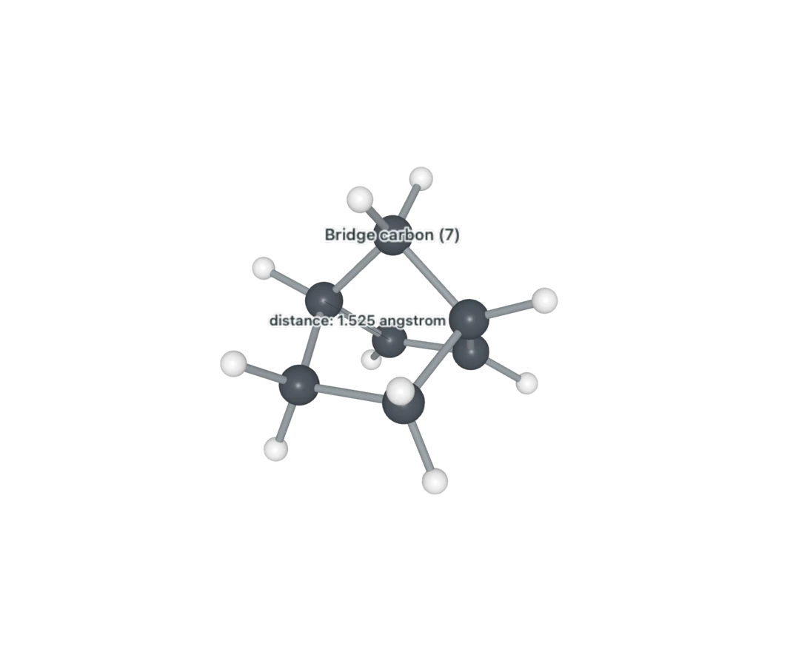

# Measure and annotate a geometry with an agent

Turn three geometry measurements into a traceable record with a named atom set, PNG, CSV and native file. Use the identified EigenVista 0.10.6 session and run each prompt after checking the prior response. [Set up EigenVista](../../setup.md) · [Quantum agent tour](../agent.md) · [GUI version](geometry-gui.md)

<figure class="tutorial-media">
  <video controls playsinline preload="none" width="1600" height="900" poster="../../../assets/media/quantum/c7h10-geometry.webp" data-kind="workflow" aria-label="Geometry measurement workflow video">
    <source src="../../../assets/media/quantum/geometry.mp4" type="video/mp4">
    <track kind="captions" src="../../../assets/media/quantum/geometry.vtt" srclang="en" label="English" default>
    <track kind="chapters" src="../../../assets/media/quantum/geometry-chapters.vtt" srclang="en" label="Chapters">
  </video>
  <figcaption>The AI connector chapter pairs the ordered geometry request with the exported measurement record.</figcaption>
</figure>

## Resolve the source atoms and measure

```text
Use my connected EigenVista session. Preserve any unsaved document to a fresh
path in Results. Open bicyclic-c7h10.molden from the approved examples, or
download it into approved Inputs from
https://uvar-apps.github.io/eigenvista/downloads/bicyclic-c7h10.molden.
Report the source elements for GUI atom numbers 1, 2, 7 and 3 and the matching
zero-based connector indices. Measure the distance for displayed atoms 1, 2,
the angle for 1, 2, 7 with atom 2 as the vertex, and the signed torsion for
1, 2, 7, 3. Keep the requested order. Report each number, unit and status.
Save three named measurement definitions and a named selection for atoms 1, 2.
```

These four source atoms are carbons. The connector inputs in order are `[0, 1]`, `[0, 1, 6]` and `[0, 1, 6, 2]`. The distance is about **1.525 Å**, the angle **100.315°** and the signed torsion **−50.383°**. The measurements describe nonperiodic geometry and the torsion sign depends on the ordered definition. [Geometry and annotation schema](https://uvar-apps.github.io/eigenvista/downloads/eigenvista-control/reference.md)

## Annotate and export

```text
Show this molecule in ball and stick, with sampled previews and surface meshes
hidden. Add a legible label "Bridge carbon (7)" to GUI atom 7. Clear transient
atom highlights. Keep the C1–C2 distance monitor visible and hide the angle
and torsion monitors to reduce overlap. Keep all three definitions. Fit the
scene and export c7h10-geometry.png and c7h10-measurements.csv to fresh paths
in Results. Open the PNG to check that the label and monitor are legible and
read the CSV to check ordered atoms, statuses and units.
```

The PNG should show the distance and bridge label. All three definitions should appear in the CSV even if two monitors are hidden. `measure.evaluate` returns numerical results. `measure.upsert` saves visible or hidden definitions, and `measure.list` lets the agent verify the stored results. `labels.upsert` creates the atom label independently of selection. [Inspection reference](https://uvar-apps.github.io/eigenvista/reference-inspection.html#measure)

### Worked results

[](../../assets/media/quantum/results/c7h10-geometry.png)

Check the published PNG and read the exported CSV. For the shown source geometry, the rows report about 1.525 Å, 100.315° and −50.383°. [Download annotated PNG](../../assets/media/quantum/results/c7h10-geometry.png){ download } · [Download measurements CSV](../../assets/media/quantum/results/c7h10-measurements.csv){ download }.

## Reopen and check

```text
Save c7h10-geometry.eigenvista to a fresh Results path and reopen it. Verify
the C1–C2 named set, three ordered measurements and bridge label are present.
Return the files and the measured values with units. Describe any difference
between the persisted document and the image's transient camera or background.
```

For research geometries, give the agent an explicit atom mapping before it compares different files. It should keep calculation provenance and atom orders with each table, and preserve undefined results as such. [Upstream geometry example](https://uvar-apps.github.io/eigenvista/tutorials-geometry.html)
