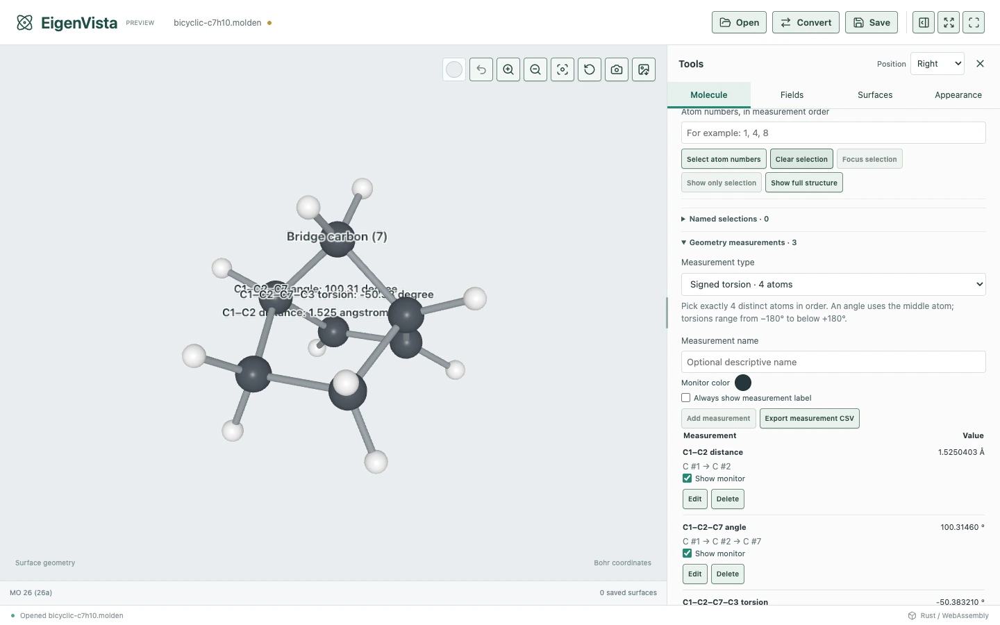
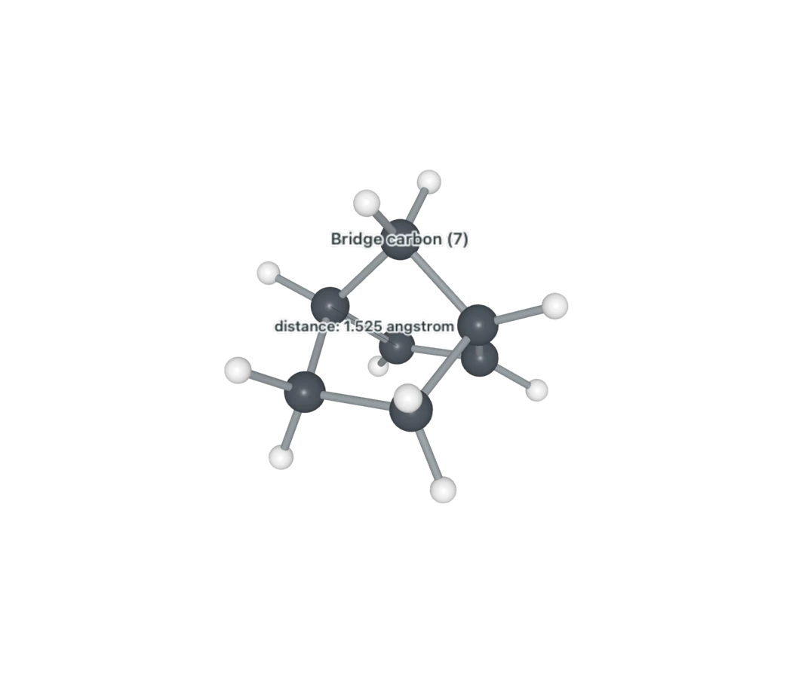

# Measure and annotate a geometry in the GUI

Record a bond length, bond angle and signed torsion from an imported molecular geometry. Keep the ordered atom identities and numerical table with a figure that makes the measured region easy to find. [Quantum GUI tour](../gui.md) · [Agent version](geometry-agent.md)

<figure class="tutorial-media">
  <video controls playsinline preload="none" width="1600" height="900" poster="../../../assets/media/quantum/geometry-measurement-controls.webp" data-kind="workflow" aria-label="Geometry measurement workflow video">
    <source src="../../../assets/media/quantum/geometry.mp4" type="video/mp4">
    <track kind="captions" src="../../../assets/media/quantum/geometry.vtt" srclang="en" label="English" default>
    <track kind="chapters" src="../../../assets/media/quantum/geometry-chapters.vtt" srclang="en" label="Chapters">
  </video>
  <figcaption>Follow the GUI chapter to enter the atom orders and read the three measurements. The AI connector chapter shows the exported figure and table.</figcaption>
</figure>

## Load and frame the geometry

Open `bicyclic-c7h10.molden` and select **Ball and stick** in **Molecule → Molecular data**. It has **17 source atoms**. Use **Fields → Quantitative field inspection → View meshes and analyses** if a sampled field obscures the model, and hide any saved meshes using their eye controls. [Download the C₇H₁₀ example](https://uvar-apps.github.io/eigenvista/downloads/bicyclic-c7h10.molden)

## Measure three ordered atom sets

1. Open **Molecule → Selections and measurements**. Type **1, 2** in the atom-number box and click **Select atom numbers**. The highlighted atom numbers are one based. Under **Named selections**, save the pair as `C1–C2 bond` with **Save named selection**.
2. Expand **Geometry measurements**, choose **Distance**, enter `C1–C2 distance` and click **Add measurement**. Verify a value near **1.525 Å**.
3. Clear the selection. Repeat with **1, 2, 7**, choose **Angle** and add `C1–C2–C7 angle`. Atom **2** is the vertex. Expect approximately **100.315°**.
4. Clear the selection and enter **1, 2, 7, 3**. Choose **Signed torsion** and add `C1–C2–C7–C3 torsion`. Verify the pick order shown by the controls before adding it. Expect approximately **−50.383°**. The convention ranges from **−180°** inclusive to **+180°** exclusive.

The measurements use the source coordinates in a nonperiodic frame. Camera movement and display radii have no effect on their values. If the coordinates make an angle or torsion degenerate, the application reports **Undefined** and gives a reason. [Measurement conventions](https://uvar-apps.github.io/eigenvista/reference-inspection.html#measure)

## Export a readable figure and verify the native file

1. In **Atom and residue labels**, set **Target** to **Atom**, **Number** to **7**, and **Label text** to `Bridge carbon (7)`. Pick a legible color and choose **Add annotation label**.
2. Clear transient selections to remove the highlight reticles. Adjust the framing. If monitors overlap, hide the angle and torsion monitors while retaining their definitions for the table, or choose **Always show measurement label** while editing to keep a monitor visible through occluding geometry.
3. Export the PNG and choose **Export measurement CSV**. Check that the CSV retains all three ordered definitions and keeps distance and degree units distinct. Save `c7h10-geometry.eigenvista`, reopen it and verify the saved named set, label and three measurements.

### Worked results

The PNG shows a readable monitor and label. The CSV retains the distance, angle, and signed torsion, with zero-based source atom indices. Compare these artifacts with the files you exported in step 3. [Download annotated PNG](../../assets/media/quantum/results/c7h10-geometry.png){ download } · [Download measurements CSV](../../assets/media/quantum/results/c7h10-measurements.csv){ download }.

For a geometry comparison across calculations, first map corresponding atoms using the producer's atom identity or an explicit mapping. Then apply the same ordered definitions to each file. A bond-length change is a direct geometry comparison. Energetic or mechanistic interpretations need evidence from the calculations themselves. [Upstream geometry example](https://uvar-apps.github.io/eigenvista/tutorials-geometry.html)
