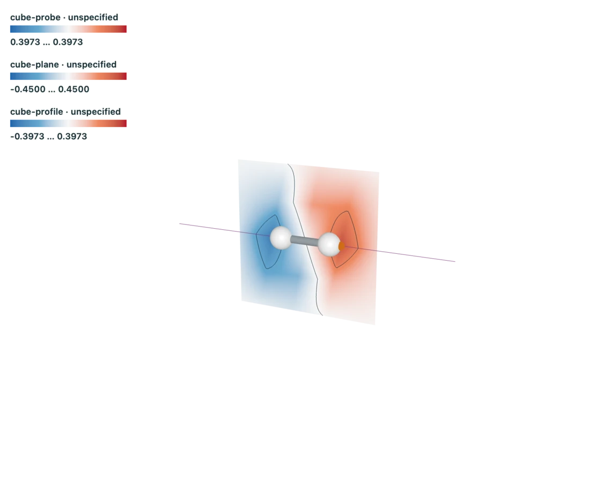

# Validate a cube slice and profile with an agent

Use a synthetic 7³ cube to check sampling, units and exported missing values before working with an unfamiliar scientific grid. Run the following prompts through an EigenVista 0.10.6 connector session. [Set up EigenVista](../../setup.md) · [Quantum agent tour](../agent.md) · [GUI version](quantitative-cube-gui.md)

<figure class="tutorial-media">
  <video controls playsinline preload="none" width="1600" height="900" poster="../../../assets/media/quantum/signed-affine-plane.webp" data-kind="workflow" aria-label="Cube section and line profile workflow video">
    <source src="../../../assets/media/quantum/quantitative-cube.mp4" type="video/mp4">
    <track kind="captions" src="../../../assets/media/quantum/quantitative-cube.vtt" srclang="en" label="English" default>
    <track kind="chapters" src="../../../assets/media/quantum/quantitative-cube-chapters.vtt" srclang="en" label="Chapters">
  </video>
  <figcaption>Use the AI connector chapter to see the expected section and sample-table checks.</figcaption>
</figure>

## Load the grid and sample a known location

```text
Use my connected EigenVista window and preserve any unsaved work in a fresh
native file before opening another document. Open signed-affine.cube from my
approved Inputs folder. If absent, download it into that folder from
https://uvar-apps.github.io/eigenvista/downloads/signed-affine.cube. Read the
grid dimensions, field meaning and units. Keep the scalar meaning and units
unspecified. Hide the 3D sampled preview so I can inspect analyses. Sample the
source grid at (1, 0, 0) bohr and tell me the value, status and sampling method.
```

Expect **2 atoms**, **1 inferred bond**, a **7 × 7 × 7** grid, and a probe value of **+0.3972682430** at a grid point. The app uses affine-grid trilinear interpolation inside the finite cube. The file's synthetic data and known grid make it suitable for verification. [Fixture definition](https://github.com/uvar-apps/eigenvista/blob/v0.10.6/fixtures/cube/README.md)

## Make the plane and profile

```text
Create an XY plane centered at (0, 0, 0) bohr, 4 × 4 bohr with 81 columns
and 81 rows. Show a diverging color map with a numeric key, fixed range -0.45
through +0.45, and contours at -0.25, 0 and +0.25. Export the plane CSV and
a PNG showing the plane and key. Then sample a line along x from (-4, 0, 0)
to (4, 0, 0) bohr, using 81 points including both endpoints. Read positions,
values and statuses and export a separate profile CSV. Use fresh Results
paths. Verify the PNG and report the paths, profile length, valid values at
x = -1, 0 and +1 bohr, and the status of each endpoint.
```

The center value is close to zero. At **−1** and **+1 bohr** expect approximately **−0.3972682430** and **+0.3972682430**. Both segment endpoints are outside and should have null samples in the connector or blank scalar cells in CSV. The complete segment is approximately **4.2334 Å** long. Connector world vectors use bohr and CSV coordinates use Å. The field's scalar unit stays unspecified.

For scrutiny of the agent's work, `analysis.create` uses a plane origin of **(−2, −2, 0)** and full spans **(4, 0, 0)** and **(0, 4, 0)** in bohr. `analysis.samples` supplies paged source samples and status. Use `table.export` with the particular analysis ID to retain each CSV. [Connector schemas and units](https://uvar-apps.github.io/eigenvista/downloads/eigenvista-control/reference.md)

### Worked results

[](../../assets/media/quantum/results/signed-affine-plane.png)

Use these verified 0.10.6 results to check your agent’s files. Look for 6,561 plane samples, 81 profile samples, and an outside status with an empty value at both ends of the profile. [Download plane PNG](../../assets/media/quantum/results/signed-affine-plane.png){ download } · [Download plane CSV](../../assets/media/quantum/results/signed-affine-plane.csv){ download } · [Download profile CSV](../../assets/media/quantum/results/signed-affine-profile.csv){ download }.

<figure class="tutorial-media">
  <video controls playsinline preload="none" width="1280" height="720" poster="../../../assets/media/concepts/cube-interpolation.webp" data-kind="concept" aria-label="Trilinear cube interpolation">
    <source src="../../../assets/media/concepts/cube-interpolation.mp4" type="video/mp4">
    <track kind="captions" src="../../../assets/media/concepts/cube-interpolation.vtt" srclang="en" label="English" default>
  </video>
  <figcaption>Follow one sample through the eight neighboring grid values. Outside the finite grid, the sample has an outside status.</figcaption>
</figure>

## Preserve and transfer the workflow

```text
Save the current document as signed-affine-inspection.eigenvista in Results at
a fresh path. Reopen it and verify that the probe, plane and profile have the
same definitions and sampled values. Tell me how the plane's 81 by 81 display
samples relate to the original 7 by 7 by 7 grid. Keep the source cube intact.
```

The point, plane and profile sample the original grid independently of the 3D render resolution. For your own cube, supply the producer's field meaning and scalar unit when you know them, and ask the agent to preserve the original values and metadata with the result. [Cube import profile](https://github.com/uvar-apps/eigenvista/blob/v0.10.6/docs/cube-import.md)
