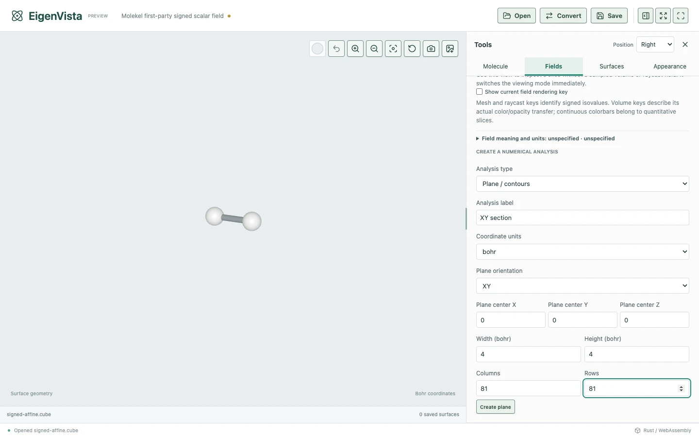
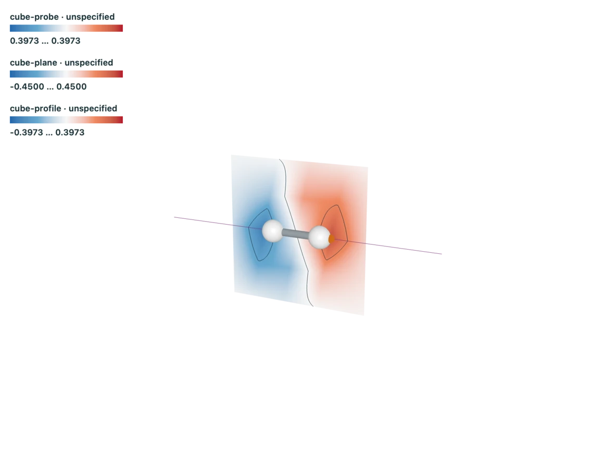

# Validate a cube slice and profile in the GUI

Check a known signed grid before applying the same inspection steps to your own scalar field. This exercise uses a mathematical fixture with a skewed grid, so the known values and finite domain make interpolation behavior visible. [Quantum GUI tour](../gui.md) · [Agent version](quantitative-cube-agent.md)

<figure class="tutorial-media">
  <video controls playsinline preload="none" width="1600" height="900" poster="../../../assets/media/quantum/cube-plane-controls.webp" data-kind="workflow" aria-label="Cube section and line profile workflow video">
    <source src="../../../assets/media/quantum/quantitative-cube.mp4" type="video/mp4">
    <track kind="captions" src="../../../assets/media/quantum/quantitative-cube.vtt" srclang="en" label="English" default>
    <track kind="chapters" src="../../../assets/media/quantum/quantitative-cube-chapters.vtt" srclang="en" label="Chapters">
  </video>
  <figcaption>Follow the GUI chapter to define a plane and see the signed contour. The AI connector chapter explains how to verify the output files.</figcaption>
</figure>

## Open the grid and identify its metadata

Open `signed-affine.cube` from the package's `Examples` directory or the public download. Expect **2 atoms**, **1 inferred bond** and a **7 × 7 × 7** grid. Its coordinates are in bohr. Keep the scalar meaning and unit unspecified in the app. The known synthetic values exercise the importer and preserve both signs. [Download the cube](https://uvar-apps.github.io/eigenvista/downloads/signed-affine.cube) · [Fixture definition and provenance](https://github.com/uvar-apps/eigenvista/blob/v0.10.6/fixtures/cube/README.md)

## Sample a point and plane

1. Open **Fields → Quantitative field inspection**, select the imported **Analysis field**, and choose **View meshes and analyses** to clear the initial volume view.
2. Under **Point probe**, use **bohr** coordinates, enter **(1, 0, 0)** and click **Create probe**. The sample should be about **+0.3972682430** and report source-grid interpolation. The fixture includes a lattice point at this coordinate.
3. Choose **Plane / contours → XY**. Center it at **(0, 0, 0)** with width **4 bohr**, height **4 bohr**, and **81 columns × 81 rows**. Click **Create plane**.
4. Expand the saved plane. Choose **Blue / white / red**, turn on **Show numeric key**, and clear **Automatic sampled range**. Use a range of **−0.45 to +0.45**, contour levels **−0.25, 0, 0.25**, then click **Apply result settings**. Use a position near face-on to see the signed lobes and zero contour.

The plane samples a continuous trilinear interpolant constructed from the stored grid. The denser section shows the interpolated shape more smoothly. The input still has only **343** grid samples. [Field inspection controls](https://uvar-apps.github.io/eigenvista/reference-inspection.html)

<figure class="tutorial-media">
  <video controls playsinline preload="none" width="1280" height="720" poster="../../../assets/media/concepts/cube-interpolation.webp" data-kind="concept" aria-label="Trilinear cube interpolation">
    <source src="../../../assets/media/concepts/cube-interpolation.mp4" type="video/mp4">
    <track kind="captions" src="../../../assets/media/concepts/cube-interpolation.vtt" srclang="en" label="English" default>
  </video>
  <figcaption>Follow one sample through the eight neighboring grid values. Outside the finite grid, the sample has an outside status.</figcaption>
</figure>

## Test the domain boundary with a profile

1. Choose **Line profile**, set start **(−4, 0, 0)** and end **(4, 0, 0)** in bohr, and create **81 samples**. The endpoints are included and the distance axis is in Å.
2. Read **Numerical samples and provenance**. Use the positions in the table below to check both signs, the center and the domain boundary. The distance along the segment is approximately **4.2334 Å**.
3. Export the plane PNG and its CSV, then export the profile CSV separately. Check that outside samples have an outside status and a blank scalar value. Coordinates and distances are exported in Å. Save `signed-affine-inspection.eigenvista` and reopen it to confirm the accepted results are retained.

| x position in bohr, y = z = 0 | Expected scalar value | Status |
| ---: | ---: | --- |
| −4 | Blank | Outside |
| −1 | −0.3972682430 | Valid |
| 0 | Approximately 0 | Valid |
| 1 | +0.3972682430 | Valid |
| 4 | Blank | Outside |

### Worked results

Export the scene with **Export image**, then use **Export analysis CSV** on the plane and the profile in turn. The plane CSV has 6,561 rows. The profile has 81 rows, including blank scalar cells at its two outside ends. [Download plane PNG](../../assets/media/quantum/results/signed-affine-plane.png){ download } · [Download plane CSV](../../assets/media/quantum/results/signed-affine-plane.csv){ download } · [Download profile CSV](../../assets/media/quantum/results/signed-affine-profile.csv){ download }.

For a real cube, keep its producer, scalar meaning, units and argument for the color range with the outputs. Coordinate units alone cannot establish scalar units. Use matched scales when the quantities and units agree, and keep the source cube as the record of what was directly sampled. [Cube import profile](https://github.com/uvar-apps/eigenvista/blob/v0.10.6/docs/cube-import.md)
